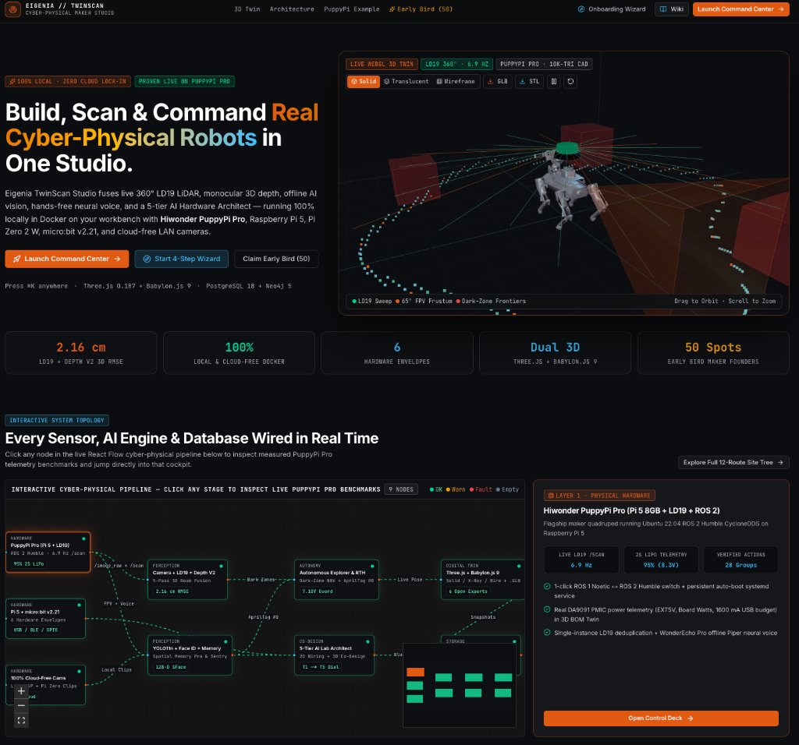
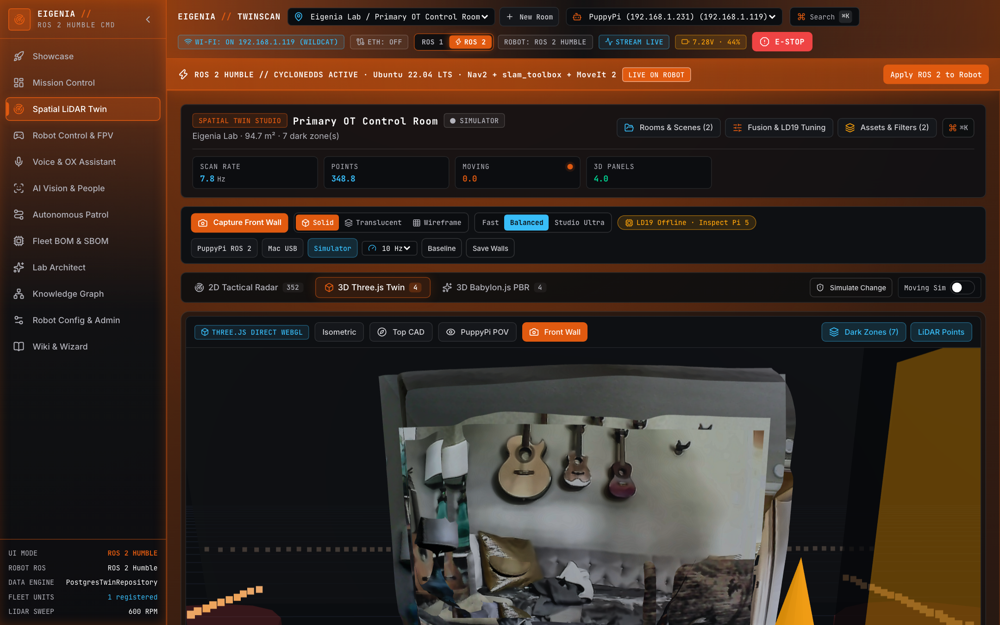
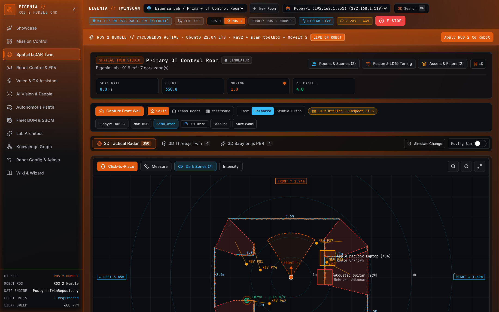
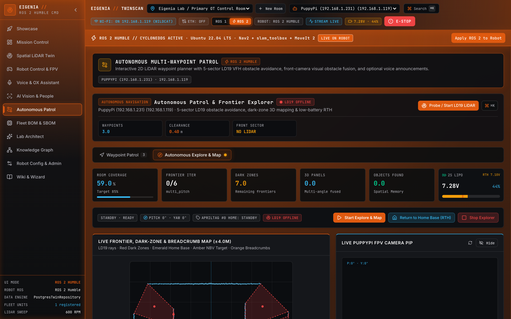
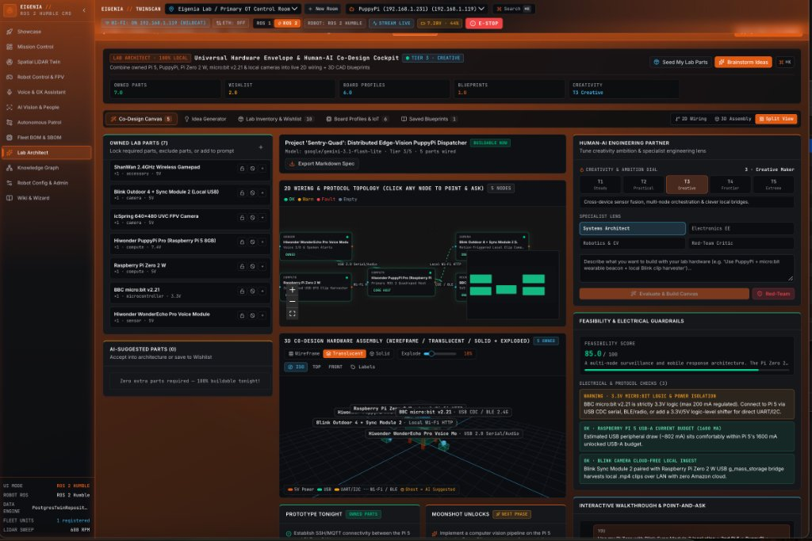
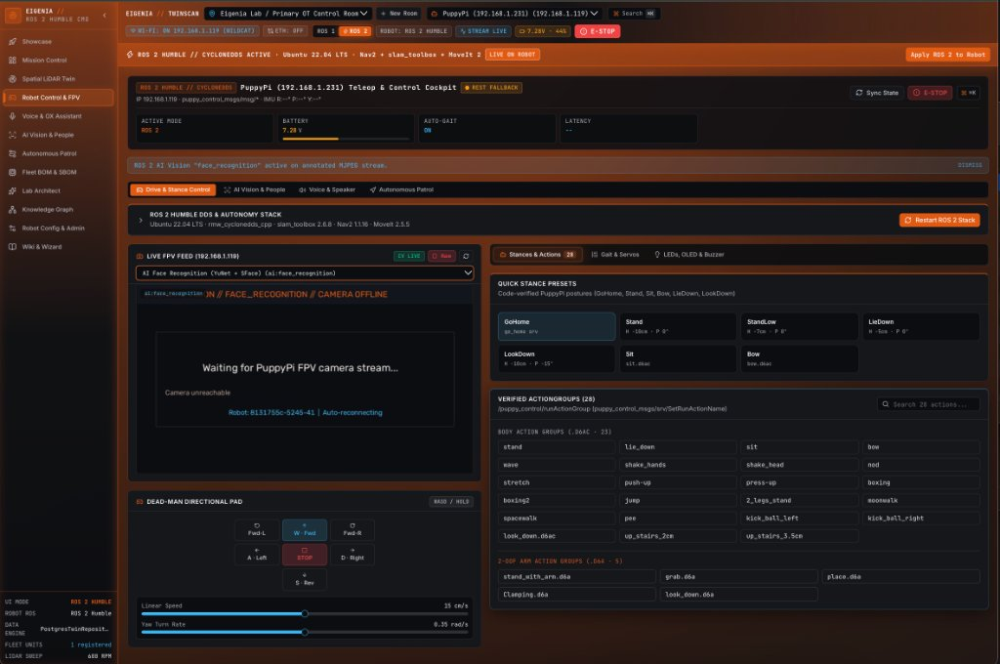
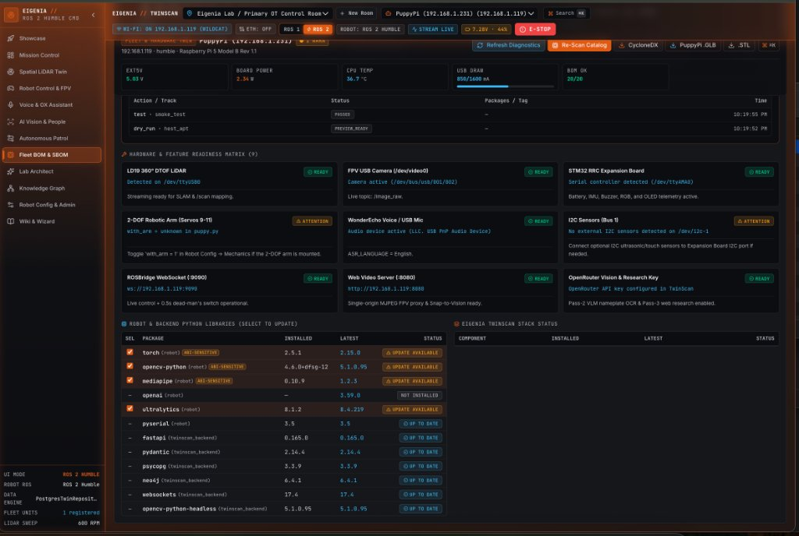
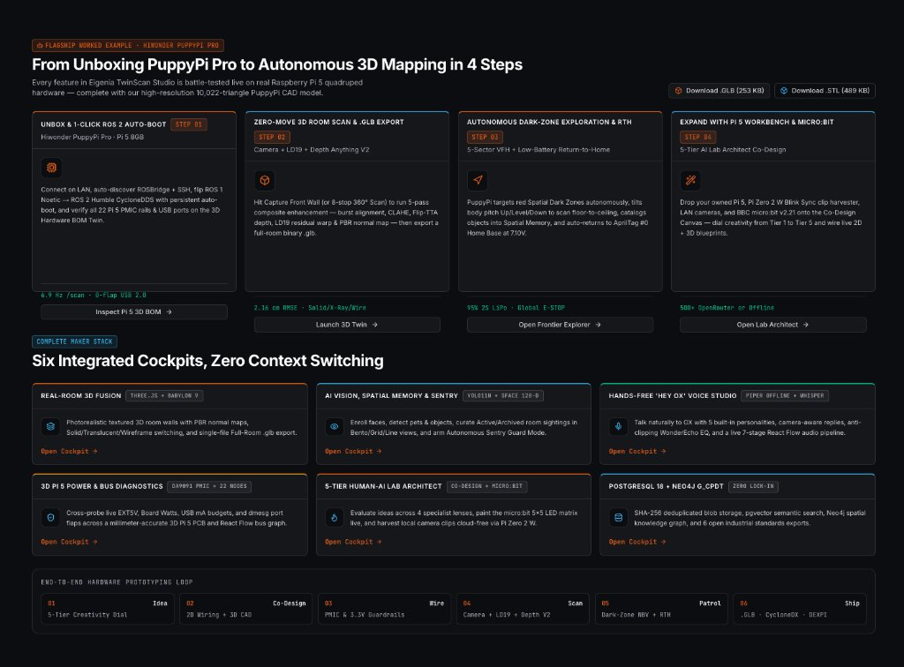
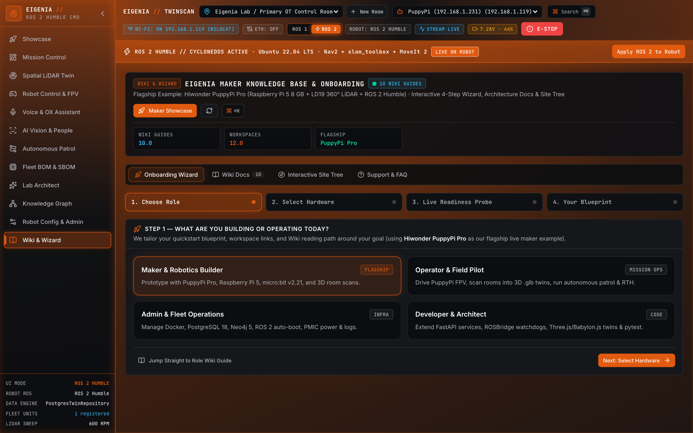
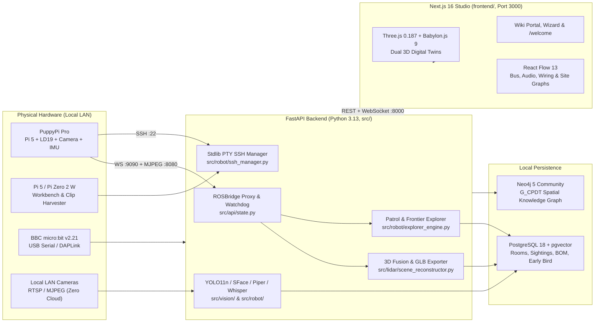

<div align="center">

# Eigenia // TwinScan Studio

**One local Docker workspace to drive real robots, scan rooms into exportable 3D models, and prototype Raspberry Pi hardware without cloud lock-in.**

[](requirements.txt)
[](frontend/package.json)
[](src/robot/ros_profiles.py)
[](frontend/src/components/twin3d)
[](docker-compose.yml)
[](src/graph/neo4j_store.py)
[](tests)
[](LICENSE)

[Quick Start](#quick-start-3-commands) · [Live Screenshots](#inside-the-studio) · [Flagship PuppyPi Pro Example](#flagship-example-hiwonder-puppypi-pro) · [Architecture](#system-architecture) · [Full Wiki (`docs/wiki/`)](docs/wiki/README.md) · [Early Bird Founders](#early-bird-maker-founders-50-spots)

<br>



</div>

---

## Why This Exists

Building a real robot or sensor lab usually turns into a pile of disconnected tools. You keep one terminal open for SSH, another for ROS launch files, a flaky RViz window for LiDAR, a separate script for camera snapshots, and a cloud app just to check a room camera. When the robot reboots or drops Wi-Fi, you start over.

**TwinScan Studio** replaces that scatter with a single local stack that runs in Docker on your laptop or workstation. You connect a robot over LAN (or start in the built-in simulator with zero hardware), scan real rooms into metric 3D meshes, run autonomous patrol and dark-zone exploration with battery-safe return-to-home, and design new Raspberry Pi 5 or micro:bit builds in the same browser window.

Everything runs on your own network. Camera feeds, voice synthesis, wake-word detection, object tracking, and spatial memory stay local.

---

## Verified Numbers From Live Hardware

Every capability below was built and tested against a real **Hiwonder PuppyPi Pro** (Raspberry Pi 5 8 GB, LD19 360° LiDAR, USB FPV camera, WonderEcho Pro audio, 2S LiPo pack) running ROS 2 Humble over Wi-Fi:

| Metric | Measured Result | Where It Runs |
| :--- | :--- | :--- |
| **3D Room Fusion Accuracy** | `2.16 cm` RMSE (129 live LD19 rays + Depth Anything V2) | `src/lidar/scene_reconstructor.py` |
| **Texture & Surface Output** | `1280×960` upscaled diffuse + baked PBR normal map + `.glb` | `src/lidar/composite_enhancer.py` |
| **Live LD19 LiDAR Rate** | `5.0–6.9 Hz`, single-instance deduplicated (`0` timeouts) | `src/robot/ssh_manager.py` |
| **Battery & RTH Telemetry** | Live 2S LiPo voltage (`8.30 V` / `95%`), auto-RTH at `7.10 V` | `src/robot/explorer_engine.py` |
| **Cloud Dependency** | `0` required cloud accounts for video, voice, or LiDAR | `src/devices/local_camera_bridge.py` |
| **Automated Verification** | `168` passing `pytest` tests (`0` warnings), `14` Next.js 16 routes | `tests/` + `frontend/` |

---

## Inside the Studio

### 1. Real-Room 3D Reconstruction & Dual WebGL Digital Twins (`/twin`)

Point the robot's camera at a wall or run an automated 360° sweep. TwinScan stacks camera frames, runs **Depth Anything V2 Small (ONNX)** with flip test-time augmentation, anchors the depth map to denoised LD19 LiDAR rays, bakes a tangent-space normal map, and writes the mesh to PostgreSQL 18. You can inspect the same room in **Three.js 0.187** or **Babylon.js 9 PBR** in `Solid`, `Translucent`, or `Wireframe` mode and download the entire room as a single binary `.glb` file.

<table>
  <tr>
    <td width="50%">
      
      <br><sub><b>3D Three.js Twin:</b> Real room wall fused from PuppyPi camera + LD19 LiDAR + Depth Anything V2.</sub>
    </td>
    <td width="50%">
      
      <br><sub><b>2D Tactical Radar:</b> Live cardinal distances, 65° camera FOV cone, dark-zone wedges, and Kalman motion tracking.</sub>
    </td>
  </tr>
</table>

### 2. Autonomous Waypoint Patrol, Frontier Explorer & Low-Battery RTH (`/patrol`)

Drop waypoints on the 2D radar or launch **Autonomous Explore & Map**. The explorer identifies unmapped dark zones, walks toward the highest-priority frontier while guarding 5 LiDAR sectors and front-camera obstacle checks, tilts the chassis (`-10° / 0° / +10°`) to scan high and low surfaces, tags recognized objects into Spatial Memory, and triggers **Return-to-Home** (with AprilTag `#0` dock homing) when the 2S LiPo pack drops below your voltage threshold. A global **E-STOP** in the top bar halts both Patrol and Explorer immediately.



### 3. Human-AI Hardware Co-Design & Universal Hardware Envelope (`/architect`)

TwinScan is not locked to one robot. `/architect` tracks the boards and sensors you own across **6 local hardware profiles** (`PuppyPi Pro`, `Raspberry Pi 5`, `Raspberry Pi Zero 2 W`, `BBC micro:bit v2.21`, `Local LAN Camera Array`, and `Generic Sensor Module`). Pick a creativity tier from `T1 Steady` to `T5 Extreme`, lock the parts you want to use, and generate a wired 2D React Flow schematic, a 3D Three.js assembly preview, electrical power guardrails (`85 / 100` feasibility checks), and a Markdown build spec.



### 4. Live Teleop, Fleet PMIC Diagnostics & 9-Point Readiness Matrix (`/control`, `/catalog`)

Drive PuppyPi over ROS 2 Humble with a server-side `0.5 s` dead-man's switch, 7 stance presets, and 28 verified action groups, while `/catalog` tracks live Raspberry Pi 5 DA9091 PMIC power (`5.03 V` EXT5V, `2.34 W` board power, `850 / 1600 mA` USB draw), hardware readiness across all 9 subsystems, and safe Python/ROS package updates.

<table>
  <tr>
    <td width="50%">
      
      <br><sub><b>Robot Control & FPV (`/control`):</b> Dead-man directional pad, quick stance presets, and 28 body + 2-DOF arm action groups.</sub>
    </td>
    <td width="50%">
      
      <br><sub><b>Fleet BOM & Readiness (`/catalog`):</b> Live Pi 5 PMIC/USB telemetry, 9-point hardware matrix, and safe library updater.</sub>
    </td>
  </tr>
</table>

### 5. Complete Maker Stack, 4-Step PuppyPi Workflow & Onboarding Wizard (`/welcome`, `/wiki`)

New makers do not have to read 200 files to get started. The `/wiki` workspace opens with a **4-step Onboarding Wizard** that picks your role and hardware, probes live `/health`, LiDAR, and battery endpoints in real time, and generates a tailored checklist alongside 11 VitePress-ready Markdown guides in `docs/wiki/`.

<table>
  <tr>
    <td width="50%">
      
      <br><sub><b>PuppyPi Pro Workflow & Maker Stack:</b> From unboxing to 3D scanning, autonomous patrol, and Pi 5 / micro:bit expansion.</sub>
    </td>
    <td width="50%">
      
      <br><sub><b>4-Step Onboarding Wizard:</b> Role selection, hardware profile, live system readiness probe, and quick-start blueprint.</sub>
    </td>
  </tr>
</table>

---

## Flagship Example: Hiwonder PuppyPi Pro

Everything in this repository ships with **Hiwonder PuppyPi Pro** as the end-to-end worked example, including a 10,022-triangle `.glb` and `.stl` CAD model in `frontend/public/models/`:

1. **Zero-Pain ROS 2 Humble Auto-Boot (`/config`):** Switch between ROS 1 Noetic (`puppypi`) and ROS 2 Humble (`puppypi_ros2`) in one click. Switching to ROS 2 installs a reversible `start_node_ros2.service` on the Pi 5, sets Docker restart policies, fixes `/dev/video*` permissions, and launches a single deduplicated `ldlidar_stl_ros2_node` after every power-cycle.
2. **Live Pi 5 Hardware Diagnostics (`/catalog`):** Reads real DA9091 PMIC voltage/current rails, total board watts, `1600 mA` USB port headroom, and microSD usage into a 22-part Three.js 3D hardware twin and React Flow bus graph, with one-click stale ROS log cleanup and CycloneDX 1.6 SBOM export.
3. **Offline Vision, Spatial Memory & Voice (`/vision`, `/voice`):** Runs local YOLO11n object detection, YuNet + SFace face recognition, AprilTag tracking, armable Sentry Guard rules, offline `piper-tts` voice synthesis, and `faster-whisper` wake-word chat (`"Hey OX"`) over the WonderEcho Pro speaker.
4. **Live FPV Drive with Server-Side Safety (`/control`):** Streams low-latency MJPEG video through FastAPI with clean socket teardown, enforces a `0.5 s` server-side dead-man's switch on velocity commands, and lets manual drive or E-STOP preempt any autonomous loop.

---

## Complete Workspace Map (12 Routes)

| Route | Workspace | What You Do Here |
| :--- | :--- | :--- |
| `/welcome` | **Maker Showcase** | Interactive 10k-tri PuppyPi 3D hero, React Flow architecture explorer, and 50-spot Early Bird Founder signup |
| `/` | **Mission Control** | Live fleet online/offline probe (15 s interval), LAN auto-discovery, Wi-Fi/Ethernet IP switcher, alerts |
| `/twin` | **Spatial LiDAR Twin** | 2D radar, Three.js + Babylon.js 3D rooms, 5-pass Camera+LD19+Depth fusion, multi-room manager, `.glb` export |
| `/control` | **Robot Control & FPV** | Live FPV stream, velocity pad with `0.5 s` dead-man watchdog, 7 stances, 6 gaits, 38 actions, arm & OLED |
| `/patrol` | **Patrol & Explorer** | Multi-waypoint VFH patrol, autonomous dark-zone frontier explorer, live FPV PiP, 2S LiPo RTH |
| `/vision` | **AI Vision & Memory** | YOLO11n, YuNet/SFace Face ID, AprilTags, Spatial Memory Pro (Bento/Grid/Line + Archive), Sentry Guard |
| `/voice` | **Voice & OX Assistant** | Offline `piper-tts` + `faster-whisper`, `"Hey OX"` voice tool-calling, OpenClaw MCP bridge, 7-stage audio flow |
| `/catalog` | **Fleet BOM & SBOM** | Live Pi 5 PMIC/USB telemetry, 22-part 3D hardware twin, CycloneDX 1.6 export, safe updater & log cleaner |
| `/architect` | **Lab Architect** | 5-tier AI co-design canvas, 2D wiring + 3D assembly, micro:bit v2.21 studio, cloud-free local camera hub |
| `/graph` | **Knowledge Graph** | Interactive React Flow Neo4j 5 (`G_CPDT`) visualizer and PostgreSQL 18 `pgvector` semantic search |
| `/config` | **Robot Config & Admin** | Encrypted OpenRouter key & 500+ model picker, SSH Wi-Fi/ROS 1↔2 auto-boot, storage & DB health |
| `/wiki` | **Wiki & Wizard** | 4-step Onboarding Wizard, searchable 10-guide Markdown reader, 16-node React Flow Site Tree, Support FAQ |

Press `⌘K` (or `Ctrl+K`) on any page to jump directly to any workspace, room, or tool.

### OpenClaw MCP Bridge & `"Hey OX"` Voice Tool-Calling

External agents (OpenClaw, Claude Desktop, or any stdio MCP client) and the in-app `"Hey OX"` voice assistant share a single 10-tool safety-checked registry in `src/agent/robot_tools.py` (`get_robot_status`, `speak_aloud`, `run_body_action`, `capture_camera_snapshot`, `recall_spatial_memory`, `start_autonomous_explore`, `return_to_home`, `stop_robot_estop`, `scan_room_wall_3d`, and `chat_as_ox`).

- **Stdio MCP Server (`src/agent/mcp_bridge.py`):** Run `.venv/bin/python -m src.agent.mcp_bridge` with `TWINSCAN_API_URL=http://localhost:8000` (zero extra dependencies) or copy the ready-made `openclaw/mcp-config.json` and `openclaw/skills/puppypi-twinscan/SKILL.md` directly from `/voice`.
- **`"Hey OX"` Live Voice Tool-Calling:** Spoken or typed commands in `/voice` run live robot tools (via OpenRouter function calling with a 3-round safety cap, or offline keyword routing when no API key is set) and speak the result back in character.

---

## System Architecture



### Technical Stack

- **Backend (`src/`, Python 3.13):** FastAPI, Uvicorn, `websockets`, `psycopg 3` + `pgvector`, `neo4j 6`, `cryptography` (Fernet key encryption), `numpy`, `scikit-learn`, `shapely`, `trimesh`, `opencv-python-headless`, `onnxruntime`, `zxing-cpp`, `piper-tts`, `edge-tts`, `faster-whisper`, `ffmpeg`, `espeak-ng`, and `openssh-client`. All application logic lives in modular packages under `src/` with zero code in `main.py`.
- **Frontend (`frontend/`, Node 22):** Next.js 16.4 (App Router), React 19, TypeScript 5.9, Tailwind CSS 4, `shadcn/ui` / Radix primitives, Three.js 0.187, Babylon.js 9.37, React Flow (`@xyflow/react` 13), and Lucide icons.
- **Data Layer (`docker-compose.yml`):** PostgreSQL 18 (`pgvector/pgvector:pg18`) with `halfvec(1536)` HNSW vector indexes and Neo4j 5 Community.

---

## Quick Start (3 Commands)

Requires **Docker Desktop** (or Docker Engine with Compose v2). No robot hardware is required to try the platform; it boots into the built-in room simulator automatically if no robot is reachable on LAN.

```bash
git clone https://github.com/Planet9V/twinscan-studio.git
cd twinscan-studio
cp .env.example .env
docker compose up -d --build

# Optional: include the portable OpenClaw gateway sidecar
docker compose --profile openclaw up -d --build
```

Running on **Windows 11 (WSL 2)**, a **Linux server / 2nd Raspberry Pi 5**, or **Railway** (including `pg_dump` migration from MacBook, Tailscale robot bridging, and database-encrypted `/config` secrets)? See the full [Cross-OS Docker, WSL 2 & Railway Deployment Guide](docs/DEPLOYMENT_DOCKER_AND_RAILWAY.md).

Once the four containers (`pg18`, `neo4j`, `backend`, `frontend`) report healthy:

| Service | Local URL | Notes |
| :--- | :--- | :--- |
| **Maker Showcase & Early Bird** | http://localhost:3000/welcome | 3D PuppyPi hero, React Flow pipeline, 50-spot signup |
| **4-Step Onboarding Wizard & Wiki** | http://localhost:3000/wiki | Live readiness check + tailored quick-start |
| **Mission Control Cockpit** | http://localhost:3000 | Fleet overview, live telemetry, global E-STOP |
| **FastAPI Interactive OpenAPI** | http://localhost:8000/docs | Full REST & WebSocket endpoint reference |
| **Neo4j Browser** | http://localhost:7474 | Default dev creds in `.env.example` |

> **Optional OpenRouter Key:** Vision nameplate identification and cloud-backed Lab Architect brainstorming use OpenRouter. Add `OPENROUTER_API_KEY` in `.env` or paste and test your key inside `/config` (encrypted with Fernet in PostgreSQL 18). All local LiDAR, 3D fusion, YOLO11n, Piper TTS, and Whisper STT features work offline without a key.

### Optional: Direct LD19 USB Bridge on macOS

Docker Desktop on macOS cannot pass `/dev/cu.usbserial-*` into Linux containers. If you plug an LD19 LiDAR directly into your Mac instead of a Raspberry Pi, run the host serial bridge:

```bash
.venv/bin/python -m src.bridge.mac_serial_bridge --ws-url ws://localhost:8000/api/lidar/ingest
```

---

## Documentation Wiki (`docs/wiki/`)

Every guide in `docs/wiki/` is traced directly to source files with line-number citations and dark-mode Mermaid diagrams, and is also readable inside the app at `/wiki?tab=docs`:

| Guide | Audience | Contents |
| :--- | :--- | :--- |
| [Wiki Index](docs/wiki/README.md) | Everyone | Reading paths by role (Maker, Operator, Admin, Developer) |
| [00 — Introduction](docs/wiki/00-introduction.md) | Newcomers | Local-first design, 6 hardware envelopes, PuppyPi Pro reference build |
| [01 — Principal-Level Guide](docs/wiki/01-onboarding-principal.md) | Senior Engineers | Core architectural insight, domain ER model, tradeoffs, reading order |
| [02 — Zero-to-Hero Path](docs/wiki/02-onboarding-zero-to-hero.md) | Contributors | Stack foundations, local setup, testing, and a 48-term robotics glossary |
| [03 — Capabilities Guide](docs/wiki/03-capabilities-guide.md) | Makers | Deep technical breakdown of all 8 platform subsystems |
| [04 — User Directions](docs/wiki/04-user-directions.md) | Operators | Step-by-step scanning, patrol, autonomous explore, E-STOP, and battery habits |
| [05 — Admin Guide](docs/wiki/05-admin-guide.md) | Fleet Admins | Docker stack, ROS 2 auto-boot, Pi 5 PMIC/USB power, stale log cleanup |
| [06 — Developer Guide](docs/wiki/06-developer-guide.md) | Developers | Backend `src/` layers, REST/WS routers, PTY SSH runner, test patterns |
| [07 — Support & Troubleshooting](docs/wiki/07-support-troubleshooting.md) | Support | Field fixes for LD19 cables, 15-char `pkill`, WonderEcho USB 2.0, `/dev/video0` |
| [08 — Site Tree](docs/wiki/08-site-tree.md) | Everyone | Every frontend route, query tab, slide-over drawer, and backend prefix |
| [Docker, WSL 2 & Railway Deployment](docs/DEPLOYMENT_DOCKER_AND_RAILWAY.md) | Operators / Cloud | macOS, Windows 11 WSL 2, `pg_dump` migration, Pi 5 server, Railway + Tailscale, DB-encrypted secrets |

---

## Local Development & Tests

```bash
# Backend test suite (168 unit & API integration tests, 0 warnings)
.venv/bin/pytest -v

# Frontend TypeScript check & production build (14 static App Router pages)
cd frontend && npm run typecheck && npm run build
```

---

## Early Bird Maker Founders (50 Spots)

TwinScan Studio includes a local **Early Bird Maker Founders** pass limited to the first **50 makers** at `http://localhost:3000/welcome#early-bird` (backed by an atomic PostgreSQL 18 cap in `src/db/robot_ai_store.py`). Founding makers get priority hardware profile support for custom Raspberry Pi, ESP32, and micro:bit rigs, direct access to all 12 workspaces and `.glb`/`.stl`/CycloneDX exporters, and founding community recognition.

---

## Frequently Asked Questions

**Can I run TwinScan Studio without owning a PuppyPi or LiDAR?**
Yes. When no robot is reachable on LAN, the backend starts in simulator mode with synthetic room geometry, moving targets, and dark zones so you can explore `/twin`, `/architect`, `/graph`, and `/wiki` right away.

**Does it send my camera feeds or voice recordings to the cloud?**
No. FPV streaming, YOLO11n object detection, Face ID, Spatial Memory, `piper-tts` speech, `faster-whisper` STT, and local RTSP/MJPEG camera ingestion all run inside your local Docker containers. External API calls only happen if you explicitly trigger an OpenRouter model.

**What happens when I power-cycle a PuppyPi after switching to ROS 2?**
Switching to ROS 2 in `/config` installs `/etc/systemd/system/start_node_ros2.service`, updates Docker restart policies (`puppypi_ros2=always`, `puppypi=no`), and leaves the stock ROS 1 service intact for one-click rollback. After a reboot, the backend's ROSBridge client reconnects automatically via its 6-second silence watchdog.

---

## License

Licensed under the [Apache License 2.0](LICENSE).
