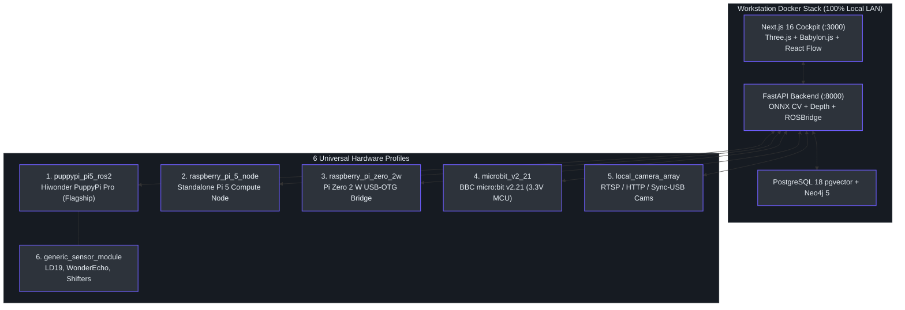
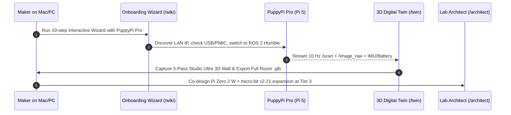

# Introduction & Hardware Ecosystem

## Overview: Why Eigenia TwinScan Exists

Home robotics kits and industrial digital twin platforms usually live in separate worlds. Affordable robots ship with brittle single-purpose mobile apps and vendor cloud lock-in, while enterprise spatial twins cost tens of thousands of dollars and require proprietary LiDAR rigs. **Eigenia TwinScan** bridges that gap: it turns a standard workstation running Docker (`docker-compose.yml:1`) and an off-the-shelf robot like the **Hiwonder PuppyPi Pro** into a full-stack spatial digital twin, autonomous explorer, local AI vision studio, conversational voice companion, and hardware co-design workbench (`src/app/factory.py:119`).

Everything runs **100% locally on your LAN** by default:
- **Zero mandatory cloud subscriptions:** ONNX vision (YuNet, SFace, YOLO11n), Depth Anything V2, Whisper STT, Piper TTS, PostgreSQL 18 + `pgvector`, and Neo4j 5 all execute inside local containers (`src/vision/robot_ai_vision.py:68`, `src/robot/conversation_engine.py:274`, `src/lidar/scene_reconstructor.py:99`).
- **Cloud-free camera harvesting:** Even consumer cameras without native RTSP (such as Blink Outdoor 4 + Sync Module 2) can be bridged locally via a Raspberry Pi Zero 2 W USB `g_mass_storage` gadget (`src/devices/local_camera_bridge.py:40`).
- **Optional LLM enrichment:** OpenRouter VLM/LLM models (`src/vision/openrouter_client.py:128`) are strictly opt-in for deep scene identification, conversational chat, and Lab Architect ideation, with deterministic offline fallbacks everywhere (`src/ai/lab_architect.py:390`).

## Architecture: The 6-Profile Universal Hardware Envelope

TwinScan models your entire workbench through 6 loadable hardware profiles defined in `src/devices/envelope.py:272`. Each profile declares its voltage rail, strict GPIO voltage limit, USB/current power budget, physical dimensions in millimeters, transports, and hard engineering limits so both runtime diagnostics and the AI Lab Architect enforce physical safety.

## Hardware Profile Comparison Table

All values below are traced directly from `DEVICE_PROFILES` in `src/devices/envelope.py:55`:

| `profile_id` | Display Name | Rail / Max GPIO | Budget | Dimensions (mm) | Primary Transports |
| --- | --- | --- | --- | --- | --- |
| `puppypi_pi5_ros2` | Hiwonder PuppyPi Pro (Pi 5 + ROS 2) | 7.4 V / 3.3 V | 5000 mA | `226 × 149 × 190` | Wi-Fi 5, ROSBridge WS, MJPEG, PTY SSH, UART RRC |
| `raspberry_pi_5_node` | Raspberry Pi 5 Model B (8 GB) | 5.0 V / 3.3 V | 5000 mA | `85 × 56 × 17` | Wi-Fi 5, Gigabit Ethernet, SSH, UART/I2C/SPI |
| `raspberry_pi_zero_2w` | Raspberry Pi Zero 2 W | 5.0 V / 3.3 V | 1200 mA | `65 × 30 × 5` | Wi-Fi 2.4 GHz, USB `g_mass_storage`, BLE |
| `microbit_v2_21` | BBC micro:bit v2.21 (nRF52833) | 3.3 V / **3.3 V** | 200 mA | `52 × 42 × 12` | USB CDC Serial (115200), DAPLink, 2.4 GHz Radio |
| `local_camera_array` | Local LAN / RTSP / Sync-USB Cams | 5.0 V / 3.3 V | 500 mA | `70 × 70 × 42` | RTSP, HTTP Snapshot, UVC, Pi Zero Clip Push |
| `generic_sensor_module` | Modular Sensor / Actuator Breakout | 5.0 V / 3.3 V | 350 mA | `45 × 38 × 25` | UART TTL, I2C, SPI, USB-Serial, PWM |

## Flagship Worked Example: Hiwonder PuppyPi Pro

Throughout this wiki, we use a real **Hiwonder PuppyPi Pro** connected to home Wi-Fi `Wildcat` (`192.168.1.119`) as our live reference build (`src/robot/pi5_diagnostics.py:192`):

1. **Compute & Power:** Raspberry Pi 5 Model B Rev 1.1 (`BCM2712`, 4× Cortex-A76 @ 2.4 GHz, 8 GB LPDDR4X, 57 GB microSD) powered via Hiwonder's 2S LiPo + 5 V buck regulator (`EXT5V = 5.033 V`, `2.35 W` idle PMIC draw, `usb_max_current_enable = 1` unlocking a `1600 mA` shared USB-A rail).
2. **USB Peripheral Topology (verified live):**
   - Port `1-1` (USB 2.0 Top): icSpring 640×480 UVC camera (`32e6:9005`, `100 mA`, `/dev/video0`).
   - Port `1-2` (USB 2.0 Bottom): WonderEcho Pro (`1a86:8091` Hub + `1a86:7523` CH340 + `0c76:161f` Audio, `302 mA`, `/dev/wonderecho`, ALSA Card 2, `0` flaps).
   - Port `3-1` (USB 3.0 Top): LDROBOT LD19 360° ToF LiDAR (`CP2102`/`CH340`, `/dev/ldlidar`, 230400 baud, ~10 Hz).
   - Port `3-2` (USB 3.0 Bottom): ShanWan 2.4 GHz wireless gamepad (`2563:0575`, `350 mA`, `/dev/input/js0`).
3. **Persistent Udev Isolation:** Because both WonderEcho Pro and certain LD19 converters use `1a86:7523` CH340 chips, TwinScan installs `/etc/udev/rules.d/99-puppypi-serial.rules` (`src/robot/ssh_manager.py:2327`) tagging parent hub `1a86:8091` to `/dev/wonderecho` and direct-port serial adapters to `/dev/ldlidar`.

## End-to-End Maker Journey

## References

- Application bootstrap and FastAPI lifespan (`src/app/factory.py:119`)
- 6 Universal Hardware Profiles and starter inventory (`src/devices/envelope.py:272`)
- Cloud-free Pi Zero 2 W USB gadget clip harvester (`src/devices/local_camera_bridge.py:40`)
- Pure-stdlib BBC micro:bit v2.21 USB bridge (`src/devices/microbit_bridge.py:113`)
- Persistent udev rules for WonderEcho vs LD19 separation (`src/robot/ssh_manager.py:2327`)
- Docker Compose 4-container local stack (`docker-compose.yml:1`)
