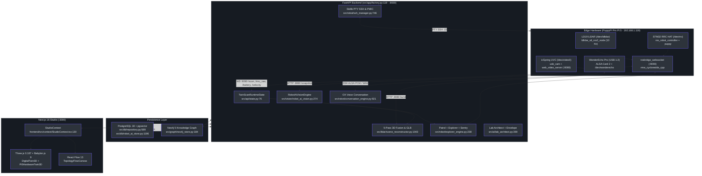
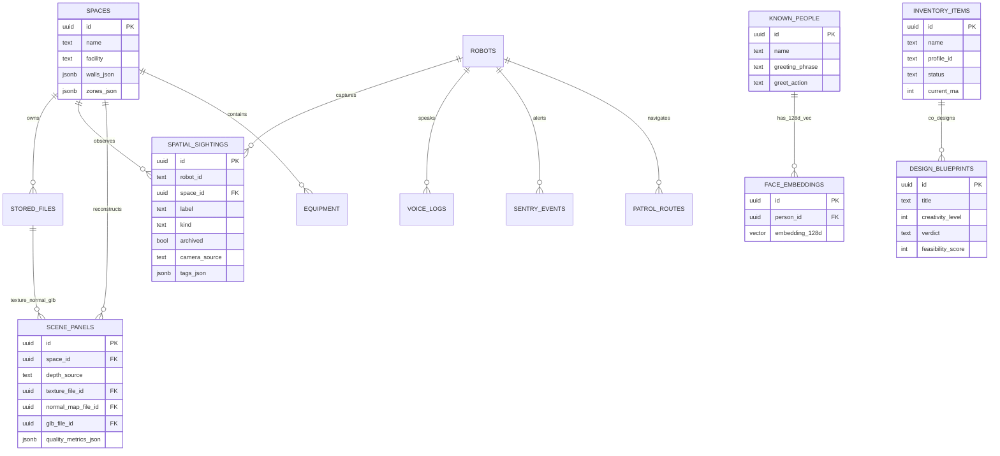

# Principal-Level Architecture Guide

This guide is written for senior and principal engineers who want to grasp Eigenia TwinScan's core mental model, invariants, and architectural tradeoffs in 10 minutes before reading code.

## The ONE Core Architectural Insight

**Treat the robot's onboard SBC (Raspberry Pi 5) strictly as a real-time I/O and safety reflex bus, and offload every heavy perception, memory, planning, and visualization loop to the workstation Docker host over typed async adapters.**

On a 4-core Raspberry Pi 5 running inside a moving 2S-LiPo quadruped (`Hiwonder PuppyPi Pro`), running Depth Anything V2, YOLO11n, YuNet+SFace, Faster-Whisper STT, Piper TTS, and RANSAC/Kalman mapping onboard would saturate CPU/thermals (`>80°C`), spike 2S LiPo current draw, and starve servo control on `/dev/ttyAMA0`. Instead, PuppyPi runs only lightweight ROS 2 Humble hardware nodes (`/puppy`, `/ros_robot_controller`, `/usb_cam`, `/web_video_server`, `/rosbridge_websocket`, and a single direct `ldlidar_stl_ros2_node` binary) (`src/robot/ssh_manager.py:2431`). The Docker backend (`src/app/factory.py:119`) ingests raw `/scan`, `/image_raw`, `/imu_raw`, and `/battery` streams, runs all neural and geometric compute in `asyncio.to_thread()` worker pools (`src/vision/robot_ai_vision.py:703`), and pushes bounded, clamped commands back over ROSBridge (`src/robot/rosbridge_proxy.py:103`).

### Core Offloading Control Loop (TypeScript Comparison Pseudocode)

Because TwinScan's backend is Python (`asyncio` + FastAPI), here is the exact cyber-physical offloading pattern expressed in TypeScript for rapid cross-language intuition:

```ts
// Equivalent TypeScript mental model for src/api/state.py + src/robot/patrol_engine.py
interface BoundedActuation {
  vxCms: number;      // clamped [-25, 25] (src/robot/rosbridge_proxy.py:103)
  yawRateRadS: number;// clamped [-1.0, 1.0]
}

async function runCyberPhysicalTick(
  runtime: TwinScanRuntime,
  robotId: string,
  ws: RosBridgeSocket
): Promise<void> {
  // 1. Ingest verified live LD19 /scan (NEVER mix simulator points into robot safety!)
  const scanAgeSec = runtime.now() - runtime.lastLiveScanMono;
  if (scanAgeSec > 4.5) {
    await ws.publishVelocity({ vxCms: 0, yawRateRadS: 0 }); // hard safety halt
    return;
  }
  if (scanAgeSec > 1.5) {
    await ws.publishVelocity({ vxCms: 0, yawRateRadS: 0 }); // paused_lidar_wait jitter window
    return;
  }

  // 2. Offload heavy CPU/ONNX work off the async event loop
  const sectors = computeFiveSectorClearances(runtime.latestRawPoints);
  const visualObstacle = runtime.aiVision.getVisualObstacle(robotId);
  const cmd: BoundedActuation = computeVfhAvoidance(sectors, visualObstacle);

  // 3. Single-writer actuation guard: E-STOP & manual teleop preempt autonomy immediately
  if (runtime.estopTriggered || runtime.manualPreempted) return;
  await ws.publishVelocity(cmd);
}
```

## System Architecture Diagram



## Domain Model ER Diagram

TwinScan splits persistence across two clean Protocol-backed repository layers (`src/db/repository.py:48` and `src/db/robot_ai_store.py:27`) so every feature runs identically against in-memory stores in `pytest` and PostgreSQL 18 + `pgvector` in Docker:



## Key Architectural Tradeoffs

| Decision | Chosen Approach | Rejected Alternative | Why & Known Consequence |
| --- | --- | --- | --- |
| **SSH Transport** | Stdlib `pty` + base64 Python payloads (`src/robot/ssh_manager.py:787`) | `paramiko` or `asyncssh` | Zero new pip dependencies and zero shell-injection surface; trades a tiny ~150 ms per-command SSH handshake overhead. |
| **Store Abstraction** | `Protocol` + `InMemory*` + `Postgres*` dual stores (`src/db/robot_ai_store.py:27`) | SQLite test shim or Docker-only tests | Full 150+ test suite runs in `<10s` with zero external services; requires keeping DDL migrations and InMemory parity in sync. |
| **3D Rendering** | Dual Three.js 0.187 + Babylon.js 9 (`frontend/src/components/twin3d/DigitalTwin3D.tsx:89`) | Single WebGL engine | Lets makers compare standard PBR vs CAD wireframe/translucent views; requires strict WebGL resource disposal on engine switch. |
| **Robot Actuation Safety** | Global E-STOP + manual teleop preemption + Patrol↔Explorer mutex (`src/api/routes_robots.py:1013`) | Independent fire-and-forget loops | Guarantees two planners never fight over `/puppy_control/velocity`; manual velocity command cleanly aborts active patrol/explorer. |
| **LiDAR Safety Isolation** | Patrol/Explorer accept ONLY verified live `robot_ros2` rays (`src/api/routes_ai_vision.py:637`) | Allowing simulator points during patrol | Prevents a physical robot from trusting fake room walls if `/scan` drops; pauses at `0 m/s` during `1.5–4.5 s` jitter and halts past `4.5 s`. |
| **Local-First Camera Ingest** | Pi Zero `g_mass_storage` + read-only loop mount (`src/devices/local_camera_bridge.py:40`) | Unofficial cloud scraping (`blinkpy`) | Eliminates 2FA breakage and cloud dependencies; introduces a ~20 s polling cadence on Sync Module 2 clip harvest. |

## Strategic Direction & "Where to Go Deep" Reading Order

If you are onboarding as a principal engineer, read these 8 files in exact order:
1. `src/app/factory.py:119` — App lifespan, dependency wiring, 15 s robot liveness probe, and startup live-LiDAR auto-attach (`_auto_attach_live_robot_lidar` at `src/app/factory.py:86`).
2. `src/api/state.py:76` — `TwinScanRuntimeState`, `process_scan()`, `compute_cardinal_distances_m()`, and the live ROS 2 `/scan` + `/imu_raw` + `/battery` bridge (`src/api/state.py:335`).
3. `src/robot/rosbridge_proxy.py:254` — ROS 1 vs ROS 2 topic/type normalization, velocity/pose/gait clamps, and global `trigger_estop()` (`src/robot/rosbridge_proxy.py:541`).
4. `src/lidar/scene_reconstructor.py:1043` & `src/lidar/composite_enhancer.py:61` — The 5-pass Studio Ultra pipeline (burst stack, CLAHE/sharpen, 2× Lanczos, Flip-TTA + He et al. guided depth, tangent-space normal maps, Taubin polish, multi-mesh `.glb`).
5. `src/robot/explorer_engine.py:238` & `src/robot/patrol_engine.py:281` — Frontier dark-zone exploration, VFH obstacle avoidance, IMU yaw fusion, mid-transit LiDAR dropout guard, and low-battery AprilTag `#0` RTH.
6. `src/vision/robot_ai_vision.py:274` — YuNet/SFace/YOLO11n/AprilTag/TrackerMIL pipeline and non-blocking MJPEG HUD stream.
7. `src/db/robot_ai_store.py:1196` — Unified Postgres 18 + `pgvector` schema for people, faces, panels, sightings, sentry, inventory, devices, and blueprints.
8. `frontend/src/context/StudioContext.tsx:130` & `frontend/src/components/layout/EigeniaShell.tsx:67` — Shared client WebSocket state, active robot/space synchronization, and global E-STOP shell.

## References

- FastAPI factory and lifespan tasks (`src/app/factory.py:119`)
- Central runtime telemetry and ROS 2 bridge (`src/api/state.py:76`)
- ROSBridge clamping, E-STOP, and LaserScan decoding (`src/robot/rosbridge_proxy.py:103`)
- 5-Pass composite enhancement and glTF 2.0 export (`src/lidar/scene_reconstructor.py:1043`)
- Autonomous frontier explorer with RTH and LiDAR guard (`src/robot/explorer_engine.py:238`)
- Dual InMemory / Postgres 18 `pgvector` AI store (`src/db/robot_ai_store.py:1196`)
- Frontend shared state provider (`frontend/src/context/StudioContext.tsx:130`)
