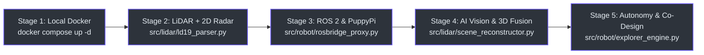
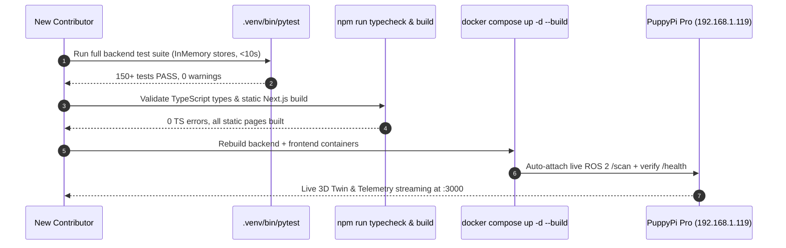

# Zero-to-Hero Learning Path

Welcome! Whether you just unboxed your first **Hiwonder PuppyPi Pro** or you are a web developer stepping into robotics and 3D spatial computing for the first time, this guide builds every concept from first principles and links directly to the production source code.

## Part I: Core Technology Foundations

Eigenia TwinScan combines five technologies into one cohesive local system (`docker-compose.yml:1`). Here is how each layer maps across Python (backend) and TypeScript (frontend):

| Concept | Python Backend (`src/`) | TypeScript Frontend (`frontend/src/`) | Why It Exists in TwinScan |
| --- | --- | --- | --- |
| **Async Concurrency** | `async def` + `asyncio.to_thread()` (`src/vision/robot_ai_vision.py:703`) | `async function` + `Promise` (`frontend/src/lib/api.ts:21`) | Keeps HTTP/WebSocket telemetry snappy while OpenCV/ONNX run on worker threads |
| **Typed Contracts** | Pydantic `BaseModel` (`src/api/routes_devices.py:33`) | `export interface` (`frontend/src/lib/architectApi.ts:15`) | Prevents silent schema drift between FastAPI and Next.js |
| **Real-Time Streams** | FastAPI `WebSocket` (`src/api/routes_lidar.py:159`) | Browser `WebSocket` in `StudioContext` (`frontend/src/context/StudioContext.tsx:130`) | Pushes 10 Hz LD19 scans, Kalman tracks, and IMU pose at `<100 ms` latency |
| **3D Graphics** | Pure-NumPy mesh & `.glb` builder (`src/lidar/scene_reconstructor.py:435`) | Three.js `0.187.0` & Babylon.js `9.37.2` (`frontend/src/components/twin3d/DigitalTwin3D.tsx:89`) | Renders metric room panels, PBR normals, and the 22-part 3D Pi 5 hardware twin |
| **Interactive Graphs** | Topology node/edge JSON (`src/ai/lab_architect.py:252`) | React Flow `@xyflow/react` (`frontend/src/components/ui/TopologyFlowCanvas.tsx:23`) | Draws clickable wiring diagrams, Pi 5 USB trees, and voice pipelines |

### Understanding ROS 2 Humble in 60 Seconds

Think of **ROS 2 Humble** (`puppypi_ros2`) as a local pub/sub message bus inside your PuppyPi Pro (`src/robot/ros_profiles.py:142`):
- **Nodes** are small independent programs: `/usb_cam` reads `/dev/video0`, `/ldlidar_published` reads `/dev/ldlidar` at `230400` baud, `/ros_robot_controller` talks to the STM32 servo/IMU board on `/dev/ttyAMA0`, and `/puppy` runs quadruped inverse kinematics.
- **Topics** are named data streams: `/scan` (`sensor_msgs/msg/LaserScan`), `/image_raw` (`sensor_msgs/msg/Image`), `/ros_robot_controller/battery` (millivolts), and `/puppy_control/velocity` (`x`, `y`, `yaw_rate`).
- **ROSBridge (`:9090`)** translates ROS 2 binary DDS messages into JSON over WebSocket so TwinScan's Python backend needs **zero local ROS installation** on macOS or Linux (`src/robot/rosbridge_proxy.py:289`).

### Learning Progression Map



## Part II: How Eigenia TwinScan Works End-to-End

Every user action flows through four crisp architectural layers (`src/app/factory.py:119`):
1. **Hardware Edge Layer:** PuppyPi Pro (Pi 5 + ROS 2 Humble), optional 2nd Pi 5 Workbench, Raspberry Pi Zero 2 W USB clip bridge, BBC micro:bit v2.21, and local LAN cameras (`src/devices/envelope.py:272`).
2. **Backend Service Layer (`src/`):** FastAPI routers (`src/api/`), LiDAR geometry & 5-pass 3D fusion (`src/lidar/`), ONNX vision (`src/vision/`), robot control/autonomy/voice (`src/robot/`), and Lab Architect (`src/ai/`).
3. **Persistence Layer (`src/db/`, `src/graph/`):** PostgreSQL 18 + `pgvector` for spaces, walls, 3D panels, 128-D face embeddings, sightings, inventory, and blueprints (`src/db/robot_ai_store.py:1196`), plus Neo4j 5 for spatial proximity graphs (`src/graph/neo4j_store.py:184`).
4. **Cockpit UI Layer (`frontend/src/`):** Next.js 16 App Router pages wrapped by `EigeniaShell` (`frontend/src/components/layout/EigeniaShell.tsx:67`) and `StudioProvider` (`frontend/src/context/StudioContext.tsx:130`).



## Part III: Local Dev Setup, Testing & Contributing

### 1. First-Time Local Setup
```bash
# Start PostgreSQL 18 (pgvector), Neo4j 5, FastAPI (:8000), and Next.js (:3000)
docker compose up -d --build

# Verify backend health and frontend reachability
curl -s http://localhost:8000/health | python3 -m json.tool
```

### 2. Running Automated Verification Locally
```bash
# Python backend tests (uses InMemoryTwinRepository + InMemoryRobotAiStore — no DB needed!)
.venv/bin/pytest -v

# Frontend strict TypeScript & production build check
cd frontend && npm run typecheck && npm run build
```

### 3. Non-Negotiable Engineering Rules for Contributors
- **No `main.py`:** All Python modules live cleanly inside `src/` (`src/app/factory.py:119`), with matching `pytest` tests in `tests/`.
- **Zero unapproved dependencies:** Reuse installed `requirements.txt` and `frontend/package.json` packages (e.g., `opencv-python-headless`, `onnxruntime`, `scipy`, `three`, `@xyflow/react`).
- **Tailwind + shadcn/ui only:** Never write raw custom CSS or hand-rolled style classes; compose `@/components/ui/*` primitives (`frontend/src/components/ui/WorkspaceHeader.tsx:39`).
- **Production error hygiene:** Wrap external HTTP/SSH/serial calls in `try/except`, log to `sys.stderr`, and retry up to 3 times (`src/robot/ssh_manager.py:746`).
- **Next.js 16 prerender safety:** Read URL query parameters inside `useEffect` via `window.location.search` rather than top-level `useSearchParams()`.

## Appendix A: 48-Term Robotics & Digital Twin Glossary

| # | Term | Plain-English Definition in TwinScan |
| --- | --- | --- |
| 1 | **2S LiPo** | Two-cell lithium-polymer battery pack (`6.6 V` empty, `7.4 V` nominal, `8.4 V` full) powering PuppyPi Pro (`src/robot/explorer_engine.py:40`). |
| 2 | **ALSA** | Advanced Linux Sound Architecture; exposes WonderEcho Pro as Card 2 (`plughw:2,0`) (`src/robot/voice_manager.py:780`). |
| 3 | **AprilTag 36h11** | High-contrast 2D fiducial square tag; Tag `#0` serves as PuppyPi's visual home charging dock marker (`src/robot/explorer_engine.py:170`). |
| 4 | **Babylon.js** | Secondary PBR 3D WebGL engine paired alongside Three.js on `/twin` (`frontend/src/components/twin3d/BabylonTwinCanvas.tsx:49`). |
| 5 | **BCM2712** | Broadcom quad-core Cortex-A76 2.4 GHz SoC inside Raspberry Pi 5 (`src/robot/pi5_diagnostics.py:192`). |
| 6 | **bMaxPower** | USB descriptor field declaring a device's maximum milliamps; summed against Pi 5's `1600 mA` rail (`src/robot/pi5_diagnostics.py:345`). |
| 7 | **BOM / HBOM** | Hardware Bill of Materials; exported as CycloneDX 1.6 JSON and cross-probed with the 3D Pi 5 twin (`src/twin/exporters.py:22`). |
| 8 | **Burst Stacking** | Aligning 3–5 camera snapshots via `cv2.phaseCorrelate` and taking the temporal median to slash sensor noise (`src/lidar/composite_enhancer.py:126`). |
| 9 | **CH340 / CP2102** | Common USB-to-UART serial bridge chips (`1a86:7523` / `10c4:ea60`) used by WonderEcho Pro and LD19 LiDAR (`src/robot/ssh_manager.py:2327`). |
| 10 | **CLAHE** | Contrast-Limited Adaptive Histogram Equalization applied to LAB luminance in Pass 2 (`src/lidar/composite_enhancer.py:197`). |
| 11 | **Cosine Similarity** | Normalized dot product (`1 - (a <=> b)` in `pgvector`) used to match 128-D SFace embeddings (`src/db/robot_ai_store.py:847`). |
| 12 | **CRC-8** | 8-bit cyclic redundancy check validating every 47-byte LD19 serial packet (`src/lidar/ld19_parser.py:99`). |
| 13 | **CycloneDX** | Industry-standard BOM/SBOM JSON specification generated for robot hardware & software (`src/robot/ssh_manager.py:1403`). |
| 14 | **DA9091 PMIC** | Dialog Power Management IC on Pi 5 exposing per-rail volts/amps via `vcgencmd pmic_read_adc` (`src/robot/pi5_diagnostics.py:192`). |
| 15 | **DAPLink** | USB interface chip on BBC micro:bit v2.21 exposing both CDC serial and drag-and-drop mass storage (`src/devices/microbit_bridge.py:113`). |
| 16 | **Dark Zone** | Unobserved occlusion shadow or unidentified cluster computed from 2D LiDAR geometry (`src/lidar/dark_zones.py:93`). |
| 17 | **DDS (CycloneDDS)** | Data Distribution Service middleware (`rmw_cyclonedds_cpp`) powering ROS 2 Humble pub/sub discovery (`src/robot/ssh_manager.py:2154`). |
| 18 | **Depth Anything V2** | Monocular neural depth ONNX model calibrated to true meters using LD19 rays (`src/lidar/scene_reconstructor.py:266`). |
| 19 | **DEXPI** | Process-industry equipment knowledge graph format exported alongside Neo4j Cypher (`src/twin/exporters.py:83`). |
| 20 | **E-STOP** | Global emergency stop zeroing robot velocity and halting patrol, explorer, vision follow, voice, and sentry (`src/api/routes_robots.py:1013`). |
| 21 | **Faster-Whisper** | Local CTranslate2 speech-to-text engine (`tiny.en`) powering offline `"Hey OX"` wake detection (`src/robot/conversation_engine.py:274`). |
| 22 | **Fernet Encryption** | Symmetric authenticated encryption protecting stored SSH passwords and API keys in Postgres (`src/db/crypto.py:35`). |
| 23 | **Flip-TTA** | Horizontal Flip Test-Time Augmentation averaging depth predictions on original and mirrored frames (`src/lidar/scene_reconstructor.py:266`). |
| 24 | **Frontier** | Boundary between known free space and an unexplored dark zone targeted by `AutonomousExplorerManager` (`src/robot/explorer_engine.py:93`). |
| 25 | **g_mass_storage** | Linux USB-OTG gadget kernel module turning Pi Zero 2 W into a virtual FAT32 drive for Blink Sync Module 2 (`src/devices/local_camera_bridge.py:40`). |
| 26 | **glTF 2.0 / .glb** | Binary 3D interchange format bundling triangle meshes, JPEG albedo, and PBR normal maps (`src/lidar/scene_reconstructor.py:744`). |
| 27 | **Guided Filter** | Edge-preserving `O(N)` He et al. filter aligning depth discontinuities cleanly to RGB edges (`src/lidar/composite_enhancer.py:366`). |
| 28 | **Hungarian Algorithm** | Optimal bipartite matching (`linear_sum_assignment`) pairing LiDAR clusters to Kalman tracks (`src/lidar/motion_tracker.py:139`). |
| 29 | **ICP Registration** | Iterative Closest Point 2D scan alignment merging multi-station scans (`src/lidar/registration.py:24`). |
| 30 | **IMU** | Inertial Measurement Unit on PuppyPi's STM32 board publishing `/ros_robot_controller/imu_raw` (`src/api/state.py:335`). |
| 31 | **Kalman Filter** | 4-state `[x, y, vx, vy]` constant-velocity estimator tracking moving objects on the 2D radar (`src/lidar/motion_tracker.py:21`). |
| 32 | **LD19 ToF LiDAR** | LDROBOT 360° Time-of-Flight laser scanner streaming 10 Hz range packets at `230400` baud (`src/lidar/ld19_parser.py:48`). |
| 33 | **Log-Odds Grid** | Probabilistic 2D occupancy grid detecting physical room anomalies against a baseline (`src/lidar/change_detection.py:50`). |
| 34 | **MJPEG** | Multipart HTTP JPEG video stream served by `web_video_server` (`:8080`) and `/ai-vision/stream` (`src/vision/robot_ai_vision.py:804`). |
| 35 | **NBV (Next-Best-View)** | Optimal `(x, y, yaw)` vantage point computed to illuminate a LiDAR dark zone (`src/lidar/dark_zones.py:71`). |
| 36 | **Normal Map** | Tangent-space RGB texture encoding micro-surface slope for crisp 3D PBR lighting (`src/lidar/composite_enhancer.py:512`). |
| 37 | **ONNX Runtime** | Cross-platform CPU neural inference runtime executing Depth Anything V2 and vision models locally (`src/lidar/scene_reconstructor.py:149`). |
| 38 | **pgvector** | PostgreSQL 18 vector extension indexing 128-D face and 1536-D semantic equipment embeddings (`src/db/robot_ai_store.py:1196`). |
| 39 | **Piper TTS** | Fast offline neural text-to-speech (`en_US-lessac-medium`) speaking through WonderEcho Pro (`src/robot/voice_manager.py:598`). |
| 40 | **RANSAC** | Random Sample Consensus iterative line fitting extracting clean room wall segments (`src/lidar/mapping.py:122`). |
| 41 | **ROSBridge** | JSON-over-WebSocket bridge (`:9090`) linking FastAPI to ROS 2 Humble topics and services (`src/robot/rosbridge_proxy.py:289`). |
| 42 | **RP1 Southbridge** | Raspberry Pi 5's PCIe-attached I/O chip driving USB 2.0/3.0, GPIO, UART, I2C, and Gigabit Ethernet (`src/robot/pi5_diagnostics.py:520`). |
| 43 | **RTH (Return-to-Home)** | Automatic return navigation triggered when 2S LiPo drops to `<=25%` (`~7.10 V`) (`src/robot/explorer_engine.py:297`). |
| 44 | **SFace / YuNet** | OpenCV Zoo ONNX face detection (YuNet) and 128-D recognition (SFace) models (`src/vision/robot_ai_vision.py:532`). |
| 45 | **Taubin Smoothing** | Two-pass `(+λ, -μ)` non-shrinking mesh polish smoothing depth noise while preserving edges (`src/lidar/composite_enhancer.py:573`). |
| 46 | **udev Rules** | Linux kernel device naming rules pinning `/dev/ldlidar` and `/dev/wonderecho` across reboots (`src/robot/ssh_manager.py:2327`). |
| 47 | **VFH Avoidance** | Vector Field Histogram steering around obstacles across 5 live LiDAR sectors (`src/robot/patrol_engine.py:38`). |
| 48 | **YOLO11n** | Ultralytics nano 80-class COCO object & animal detector running locally via `cv2.dnn` (`src/vision/robot_ai_vision.py:613`). |

## Appendix B: Key File Reference

| Path | Responsibility |
| --- | --- |
| `docker-compose.yml:1` | 4-container local stack (PG18 `pgvector`, Neo4j 5, FastAPI backend, Next.js frontend) |
| `src/app/factory.py:119` | FastAPI factory, router mounting, liveness loop, and startup live-LiDAR auto-attach |
| `src/api/state.py:76` | Runtime state, LiDAR processing, cardinal clearances, and ROS 2 bridge task |
| `src/robot/pi5_diagnostics.py:192` | Live Pi 5 DA9091 PMIC parser, USB power accounting, and 22-component 3D BOM health |
| `frontend/src/components/layout/EigeniaShell.tsx:67` | Navigation rail, global E-STOP bar, and full-bleed `/welcome` passthrough |
