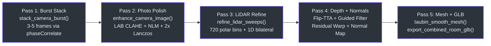
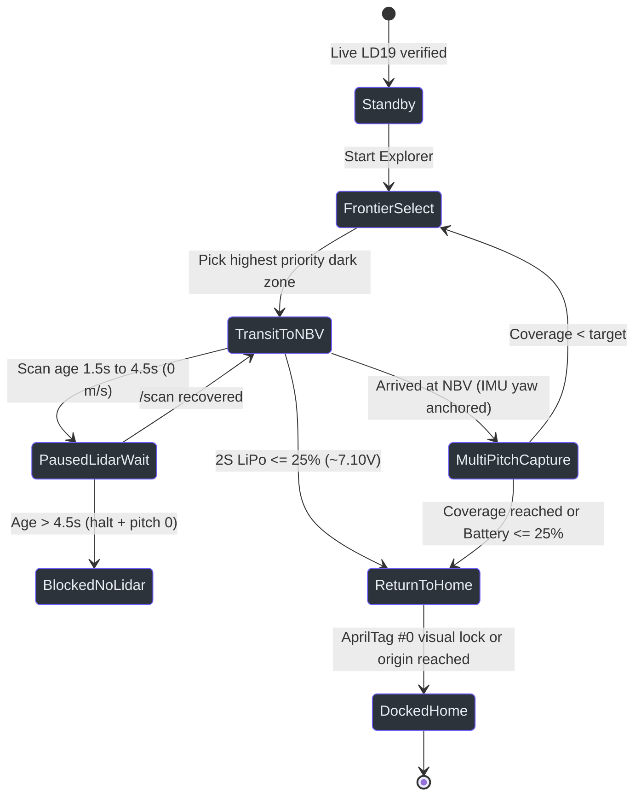

# Complete Capabilities Deep-Dive

Eigenia TwinScan unifies eight tightly integrated capabilities on top of a single local Docker runtime (`src/app/factory.py:119`). This guide explains **why** each capability exists, **how** it works in code, and **how** it runs live on the **Hiwonder PuppyPi Pro**.

## Capability Matrix

| Capability | Primary UI Route | Core Backend Module(s) | Verified PuppyPi Pro Benchmark |
| --- | --- | --- | --- |
| **1. 5-Pass 3D Room Fusion & Dual Engines** | `/twin` | `src/lidar/composite_enhancer.py:61`, `src/lidar/scene_reconstructor.py:1043` | `2.16 cm` LD19 RMSE, `1280×960` texture + PBR normal map + `.glb` |
| **2. Live 2D Radar, Kalman & Orientation** | `/twin` | `src/api/state.py:37`, `src/lidar/motion_tracker.py:93` | `6.9–10 Hz` live `/scan`, `90°` forward lock, `2–20 Hz` polling |
| **3. Autonomous Patrol, Explorer & RTH** | `/patrol` | `src/robot/patrol_engine.py:281`, `src/robot/explorer_engine.py:238` | 5-sector VFH, IMU yaw anchor, `<=25%` 2S LiPo RTH + AprilTag `#0` |
| **4. AI Vision, Spatial Memory Pro & Sentry** | `/vision` | `src/vision/robot_ai_vision.py:274`, `src/robot/sentry_manager.py:75` | 6 CV modes (`YuNet/SFace`, `YOLO11n`, `TrackerMIL`, `AprilTag`), 3 gallery views |
| **5. Conversational Voice Assistant ("Hey OX")** | `/voice` | `src/robot/conversation_engine.py:921`, `src/robot/voice_manager.py:598` | Piper TTS + Faster-Whisper offline loopback (`1.5 s`), Card 2 auto-detect |
| **6. 5-Tier AI Lab Architect Co-Design** | `/architect` | `src/ai/lab_architect.py:390`, `src/api/routes_devices.py:30` | 5 creativity tiers, 4 specialist lenses, live 2D wiring + 3D assembly |
| **7. Pi 5 PMIC & 22-Component 3D BOM Twin** | `/catalog` | `src/robot/pi5_diagnostics.py:192`, `frontend/src/components/robot/Pi5HardwareTwin3D.tsx:314` | `EXT5V 5.033 V`, `2.35 W`, `752/1600 mA` USB, bidirectional 3D↔BOM sync |
| **8. Universal Hardware Envelope & Graph** | `/architect`, `/graph` | `src/devices/envelope.py:272`, `src/graph/neo4j_store.py:184` | 6 board profiles, micro:bit USB bridge, cloud-free Pi Zero clip harvester |

---

## 1. 5-Pass 3D Camera + LD19 + Depth V2 Fusion

Why just draw flat 2D lines when PuppyPi has both a 640×480 FPV camera and a 360° LD19 ToF LiDAR? `reconstruct_enhanced_wall_panel()` (`src/lidar/scene_reconstructor.py:1043`) executes a configurable 5-pass pipeline (`fast`, `balanced`, `studio_ultra`) defined in `src/lidar/composite_enhancer.py:61`:

- **Exact math, zero exotic deps:** Pass 4 implements He et al.'s `O(N)` RGB-guided filter using pure `cv2.boxFilter` (`src/lidar/composite_enhancer.py:366`), warps column depth residuals against true LD19 rays (`src/lidar/composite_enhancer.py:420`), bakes tangent-space PBR normal maps (`src/lidar/composite_enhancer.py:512`), and applies non-shrinking Taubin smoothing (`src/lidar/composite_enhancer.py:573`).
- **Dual 3D Renderers + Full-Room `.glb`:** Both Three.js `0.187.0` (`frontend/src/components/twin3d/DigitalTwin3D.tsx:89`) and Babylon.js `9.37.2` (`frontend/src/components/twin3d/BabylonTwinCanvas.tsx:49`) render every panel in **Solid (Shaded)**, **Translucent**, or **Wireframe** modes with live normal maps. `GET /api/spaces/{space_id}/reconstruct/export-room.glb` (`src/api/routes_twin.py:1038`) exports all panels as a single multi-mesh binary glTF 2.0 scene (`src/lidar/scene_reconstructor.py:744`).

## 2. Autonomous Patrol, Dark-Zone Explorer & Low-Battery RTH

`AutonomousExplorerManager` (`src/robot/explorer_engine.py:238`) and `RobotPatrolManager` (`src/robot/patrol_engine.py:281`) share strict mutual exclusion (`src/api/routes_ai_vision.py:637`) and real-time safety interlocks:

- **Hardened LiDAR Safety:** During `_transit_to()` (`src/robot/explorer_engine.py:547`) and `_patrol_loop()` (`src/robot/patrol_engine.py:361`), if live `/scan` drops for `1.5–4.5 s`, velocity immediately zeroes (`paused_lidar_wait`) to ride out brief Wi-Fi jitter; past `4.5 s`, autonomy halts cleanly with pitch reset to `0°`. Simulator points are **never** fed to robot safety loops.
- **2S LiPo Battery & AprilTag `#0` Home:** `compute_battery_pct_2s()` (`src/robot/explorer_engine.py:40`) maps `6.6–8.4 V` linearly to `0–100%`, triggering RTH at `<=25%` (`~7.10 V`), and `detect_apriltag_home_in_jpeg()` (`src/robot/explorer_engine.py:170`) locks onto AprilTag `36h11` ID `#0` during home approach.

## 3. AI Vision Studio, Spatial Memory Pro & Sentry Guard

- **6 Live Offloaded Modes (`src/vision/robot_ai_vision.py:274`):** `raw`, `face_recognition` (YuNet + SFace + `pgvector` cosine match), `object_animal` (YOLO11n 80 COCO classes), `track_follow` (YOLO + `cv2.TrackerMIL_create()` fallback + 5-frame lost halt), `line_follow` (3-band HSV centroid PID + live eyedropper), and `apriltag` (OpenCV 5.1-safe 1D `ids` parsing at `src/vision/robot_ai_vision.py:674`).
- **Offline Camera HUD:** If PuppyPi's camera is temporarily unreachable, `stream_annotated_mjpeg()` yields a crisp dark Eigenia status JPEG instead of hanging the browser `` indefinitely.
- **Spatial Memory Pro (`src/api/routes_ai_vision.py:1142`):** Full lifecycle management (`Active`, `Archived`, `All`), multi-select bulk actions, 3 gallery views (**Bento Grid**, **Small Picture Grid**, **Line View**), and a slide-over editor (`frontend/src/components/vision/SpatialMemoryGallery.tsx:107`).
- **Sentry Guard (`src/robot/sentry_manager.py:75`):** Arms watch triggers (unknown face, animal, LiDAR zone intrusion) that log snapshots, trigger spoken personality challenges, and flash STM32 RGB/buzzer alerts.

## 4. Conversational Voice Assistant ("Hey OX")

- **Dynamic USB Audio Detection:** `parse_usb_audio_card_index()` (`src/robot/voice_manager.py:780`) automatically locates WonderEcho Pro (`0c76:161f`) whether Linux assigns it ALSA Card 2 or Card 3, conditioning WAV output (`-3 dB` + 120 ms lead-in) to prevent speaker clipping (`src/robot/voice_manager.py:450`).
- **Custom Offline Wake Word & Spatial Queries:** `RobotConversationManager` (`src/robot/conversation_engine.py:921`) streams 16 kHz PCM from PuppyPi's mic, matches `"Hey OX"` (plus custom phonetic aliases) via Faster-Whisper, answers spatial memory queries (*"Hey OX, where is my backpack?"*), and executes bounded ROS 2 robot actions.

## 5. 5-Tier AI Lab Architect & Universal Hardware Envelope

- **Co-Design Engine (`src/ai/lab_architect.py:390`):** Evaluates ideas across **5 Creativity Tiers** (`1 Steady & Proven` through `5 Extreme / Groundbreaking`) and **4 Specialist Lenses** (`Systems Architect`, `Electronics EE`, `Robotics & CV`, `Red-Team Critic`), running deterministic electrical guardrails (`3.3 V micro:bit vs 5 V Pi`, `1600 mA Pi 5 USB budget`, `Blink no-RTSP`, `LD19 4-wire data cable`) and outputting synchronized 2D React Flow wiring graphs (`src/ai/lab_architect.py:252`) + proportional Three.js 3D hardware assemblies (`frontend/src/components/architect/CoDesignAssembly3D.tsx:295`).
- **Multi-Device Bridges:** Includes pure-stdlib BBC micro:bit v2.21 USB CDC serial & 5×5 LED matrix studio (`src/devices/microbit_bridge.py:174`) and 100% cloud-free local camera/MP4 ingest + Pi Zero 2 W `g_mass_storage` clip harvester generator (`src/devices/local_camera_bridge.py:40`).

## 6. Live Pi 5 PMIC Diagnostics, 3D BOM Twin & Neo4j Knowledge Graph

- **22-Component 3D Pi 5 Twin:** `collect_pi5_hardware_diagnostics()` (`src/robot/pi5_diagnostics.py:1118`) reads DA9091 PMIC ADC volts/amps/watts, throttle bitmasks, USB-A `bMaxPower` draw, `dmesg` port flaps, and microSD usage into 22 canonical 3D meshes in `Pi5HardwareTwin3D.tsx:314` with bidirectional BOM cross-probing.
- **Spatial Knowledge Graph (`src/graph/neo4j_store.py:184`):** Syncs spaces, equipment assets, spatial proximity edges (`compute_proximity_edges` at `src/graph/neo4j_store.py:20`), and semantic embeddings for cross-room search and CycloneDX/DEXPI/DXF/PLY/glTF export (`src/twin/exporters.py:22`).

## References

- 5-Pass composite enhancement pipeline (`src/lidar/composite_enhancer.py:61`)
- Depth calibration and combined `.glb` exporter (`src/lidar/scene_reconstructor.py:744`)
- Autonomous frontier explorer and RTH (`src/robot/explorer_engine.py:238`)
- VFH obstacle avoidance patrol loop (`src/robot/patrol_engine.py:38`)
- AI Vision engine (`src/vision/robot_ai_vision.py:274`)
- Conversational voice engine (`src/robot/conversation_engine.py:921`)
- Lab Architect 5-tier co-design engine (`src/ai/lab_architect.py:390`)
- Pi 5 PMIC and 3D BOM diagnostics (`src/robot/pi5_diagnostics.py:192`)
