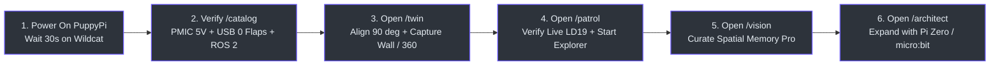
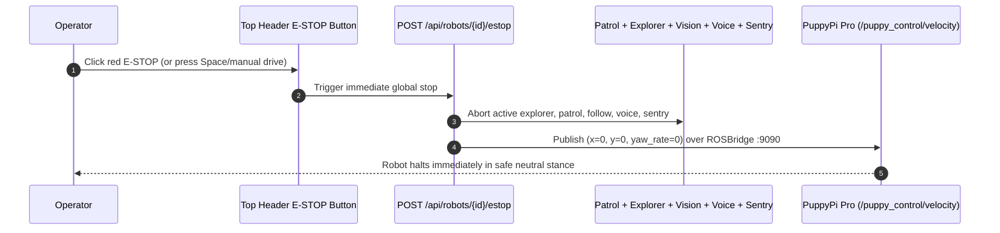

# User Directions & PuppyPi Pro Operating Guide

This operator manual walks you through running your **Hiwonder PuppyPi Pro** safely and effectively from power-on to 3D room capture, autonomous exploration, Spatial Memory curation, and hardware expansion.

## 1. Pre-Flight Safety & First-Run Checklist

Before powering on PuppyPi Pro:
1. **Place on a flat, clear surface** (at least `1.5 m × 1.5 m` unobstructed floor area; keep away from stairs and table edges).
2. **Verify physical USB-A connections on Raspberry Pi 5** (`src/robot/pi5_diagnostics.py:420`):
   - **Black USB 2.0 Top (`1-1`):** icSpring UVC front camera.
   - **Black USB 2.0 Bottom (`1-2`):** WonderEcho Pro voice module (avoid blue USB 3.0 ports to prevent audio/serial flaps).
   - **Blue USB 3.0 Top (`3-1`):** LD19 LiDAR CP2102/CH340 converter using a **verified 4-wire data USB cable** (not charge-only).
   - **Blue USB 3.0 Bottom (`3-2`):** ShanWan wireless gamepad receiver.
3. **Verify 2S LiPo charge:** Keep voltage `>= 7.4 V` (`>= 45%`) before starting autonomous exploration (`src/robot/explorer_engine.py:40`).
4. **Power on PuppyPi Pro** and wait `~25–35 s` for Wi-Fi (`Wildcat`, `192.168.1.119`) and the persistent ROS 2 Humble auto-boot service (`start_node_ros2.service`) to bring up all nodes (`src/robot/ssh_manager.py:536`).

## Operator Workflow Flow

## 2. Connecting & Verifying Hardware Health (`/catalog` & `/control`)

1. Open **`http://localhost:3000/catalog`** (or run the interactive 10-step wizard at `/wiki?tab=wizard`).
2. Click **`Refresh Live Pi 5 Diagnostics`** (`GET /api/robots/{id}/hardware-diagnostics` at `src/api/routes_robots.py:1670`) and verify:
   - **`EXT5V`** reads `~4.95–5.05 V` and **`Throttled`** reads `0x0`.
   - **USB Budget** shows `usb_max_current_enable = true` (`1600 mA` cap, `<1200 mA` used).
   - **LD19 LiDAR** status is **`ok`** (`/dev/ldlidar -> ttyUSB*`) and **WonderEcho Pro** shows `0 flaps`.
   - If MicroSD usage is `>= 85%`, click **`Clean Stale Logs`** (`src/api/routes_robots.py:1686`).
3. Open **`/control`** to verify live FPV video (`:8080/snapshot?topic=/image_raw`), live 2S LiPo voltage, and click **`Stand / Go Home`** (`src/robot/rosbridge_proxy.py:619`) to confirm servo responsiveness.

## 3. Scanning Rooms into 3D & Exporting `.glb` (`/twin`)

1. Open **`/twin`** and verify the LiDAR source bar shows **`PuppyPi ROS 2`** with live `~7–10 Hz` scans (`src/api/routes_lidar.py:88`).
2. **Orient Forward:** Confirm the **Rotation Offset** is `90°` (so the **Front** cardinal distance matches what PuppyPi's front camera faces; `src/api/state.py:37`).
3. **Create or Select a Room Scene:** Use the Room Manager dropdown to create a named room (e.g., `"Main Robotics Lab"`) or clone a checkpoint (`src/api/routes_twin.py:179`).
4. **Choose Quality Preset (`src/lidar/composite_enhancer.py:61`):**
   - **`Fast`**: Single frame, quick preview.
   - **`Balanced` (default)**: 3-frame burst denoise + LAB CLAHE + Flip-TTA guided depth + PBR normal map + Taubin polish.
   - **`Studio Ultra`**: 5-frame burst + `2×` Lanczos (`1280×960`) texture + NLM denoise + full PBR normal map.
5. Click **`Capture Wall (Zero Movement)`** (`src/api/routes_twin.py:709`) to test stationary fusion, or **`Capture 360° Room`** (`src/api/routes_twin.py:865`) to sweep the room using live IMU yaw steps.
6. Toggle **3D Three.js Twin** and **3D Babylon.js PBR** across **`Solid (Shaded)`**, **`Translucent`**, and **`Wireframe`**, then click **`Download Full Room .glb`** (`src/api/routes_twin.py:1038`) to export for Blender, Unity, or CAD.

## 4. Running Autonomous Patrol & Frontier Exploration (`/patrol`)

1. Open **`/patrol`** and verify the green **`LD19 LIVE`** badge and all 5 sector distances (`Left`, `Front-Left`, `Front`, `Front-Right`, `Right`) are updating (`src/robot/patrol_engine.py:140`).
2. **Place AprilTag `36h11` `#0`** at your charging/home mat if using visual Return-to-Home docking (`src/robot/explorer_engine.py:170`).
3. **Waypoint Patrol tab:** Click points on the 2D radar to lay down waypoints, set `Obstacle Clearance` (`>= 0.45 m` recommended indoors), and click **`Start Patrol`**.
4. **Autonomous Explorer tab:** Choose **`Multi-Pitch (Floor + Eye + High)`**, set `Target Coverage %` (e.g., `80%`) and `Low-Battery RTH %` (`25%`), and click **`Start Autonomous Exploration`** (`src/robot/explorer_engine.py:353`).
5. Expand the **Live PuppyPi FPV PiP** card beside the map to monitor real-time obstacle avoidance, pitch sweeps, and `APRILTAG #0 LOCKED` cues.

## 5. Emergency Stop (E-STOP) & 2S LiPo Battery Safety

| Safety Rule | Exact Threshold / Behavior | Code Source |
| --- | --- | --- |
| **Global E-STOP** | Immediately halts Explorer, Patrol, AI Vision follow/line-follow, Voice loop, and Sentry, then sends `(0, 0, 0)` velocity | `src/api/routes_robots.py:1013` |
| **Manual Teleop Preemption** | Any manual velocity, action, or Go-Home command automatically stops active Patrol or Explorer before executing | `src/api/routes_robots.py:725` |
| **Patrol ↔ Explorer Mutex** | Starting Patrol automatically stops Explorer (and vice versa) so two planners never compete | `src/api/routes_ai_vision.py:637` |
| **Mid-Transit LiDAR Loss** | `1.5–4.5 s` stale `/scan` zeroes velocity (`paused_lidar_wait`); `>4.5 s` halts safely (`blocked_no_lidar`) and levels pitch to `0°` | `src/robot/explorer_engine.py:547` |
| **2S LiPo Low-Battery RTH** | Auto-triggers Return-to-Home at `<=25%` (`~7.10 V`); **never** discharge a 2S LiPo below `6.6 V` — charge immediately on a balanced 2S charger | `src/robot/explorer_engine.py:40` |

## 6. Curating Spatial Memory & Prototyping in Lab Architect

- **Spatial Memory Pro (`/vision` -> Spatial Memory tab):** Switch between **Bento Grid**, **Small Picture Grid**, and **Line View**; filter by `Active / Archived / All` and kind (`Face`, `Animal`, `Object`, `Scene`); click any card to open the slide-over inspector to rename, tag, download JPEG, archive, or delete (`frontend/src/components/vision/SpatialMemoryGallery.tsx:107`).
- **Hands-Free Voice (`/voice`):** Run the 6-step **Diagnostics & Test** tab (`Record 4s & Test Saying "Hey OX"`), add any heard phonetic alias in 1 click, then enable **Hands-Free Mode** to ask *"Hey OX, what do you see?"* or *"Hey OX, where is my backpack?"* (`src/robot/conversation_engine.py:971`).
- **Lab Architect (`/architect`):** Click **`Seed My Lab Parts`** (`src/devices/envelope.py:294`), dial **Creativity Tier 1–5**, choose a specialist lens (`Systems Architect`, `Electronics EE`, `Robotics & CV`, `Red-Team Critic`), click **`Evaluate & Build Canvas`**, inspect the 2D wiring + 3D assembly side-by-side, and export a Markdown build spec (`src/ai/lab_architect.py:390`).

## References

- Global E-STOP and manual preemption (`src/api/routes_robots.py:1013`)
- 2S LiPo mapping, AprilTag `#0`, and mid-transit LiDAR guard (`src/robot/explorer_engine.py:40`)
- 5-sector live patrol obstacle avoidance (`src/robot/patrol_engine.py:38`)
- 3D room capture and combined `.glb` export routes (`src/api/routes_twin.py:709`)
- Spatial Memory Pro gallery component (`frontend/src/components/vision/SpatialMemoryGallery.tsx:107`)
- Lab Architect evaluation and electrical checks (`src/ai/lab_architect.py:390`)
