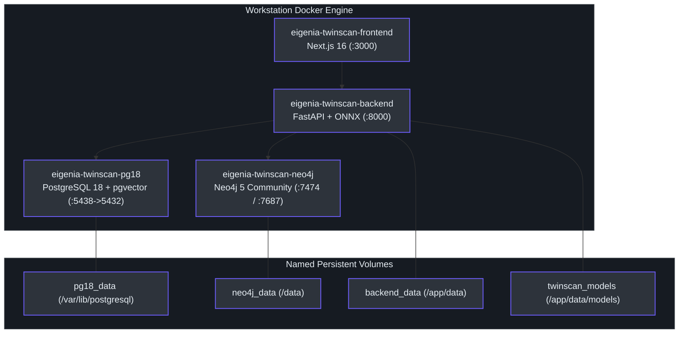
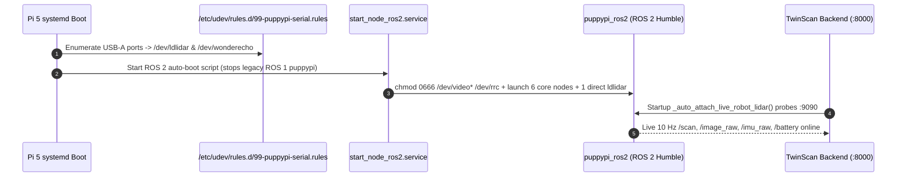

# Admin & Fleet Operations Guide

This guide covers everything lab administrators and fleet operators need to keep Eigenia TwinScan, its databases, and its Raspberry Pi 5 fleet running reliably across reboots with zero cloud dependencies.

## 1. Docker Compose Production Stack

Eigenia TwinScan deploys as 4 isolated containers defined in `docker-compose.yml:1`:

### Core Stack Operations
| Task | Command | Notes |
| --- | --- | --- |
| Build & start all 4 containers | `docker compose up -d --build` | Runs healthchecks on PG18 and Neo4j before backend starts (`docker-compose.yml:64`) |
| Check health & DB connectivity | `curl -s http://localhost:8000/health` | Verifies Postgres, Neo4j, active space, and OpenRouter config (`src/app/factory.py:231`) |
| Inspect backend logs | `docker logs -f --tail 100 eigenia-twinscan-backend` | All external SSH/HTTP/ONNX errors log to `stderr` |
| Backup PostgreSQL 18 database | `docker exec eigenia-twinscan-pg18 pg_dump -U twinscan eigenia_twinscan > backup.sql` | Captures spaces, 3D panels, face vectors, sightings, inventory, blueprints |
| Verify ONNX model cache | `docker exec eigenia-twinscan-backend ls -lh /app/data/models/` | Persisted in `twinscan_models` volume (YuNet, SFace, YOLO11n, Depth V2, Piper, Whisper) |

## 2. Persistent ROS 1 ↔ ROS 2 Auto-Boot on PuppyPi Pro

By default, Hiwonder's factory `start_node.service` boots the ROS 1 Noetic container (`puppypi`) on every power-up. TwinScan provides a persistent ROS 2 Humble boot script and systemd unit (`render_ros2_boot_script()` at `src/robot/ssh_manager.py:536` and `render_ros2_systemd_unit()` at `src/robot/ssh_manager.py:607`) so PuppyPi boots straight into **ROS 2 Humble** (`puppypi_ros2`) cleanly after every battery swap:

- **Persistent Wi-Fi Hardening:** On PuppyPi Pro, stock `wifi.service` runs `wifi.py` which can wipe `/etc/NetworkManager/system-connections/*` on boot. Administrators should keep `wifi.service` disabled and rely on a persistent NetworkManager STA profile (`autoconnect=yes`, `autoconnect-priority=10`, `802-11-wireless.powersave=2`) with `cfg80211.ieee80211_regdom=US` in `/boot/firmware/cmdline.txt`.
- **Single-Instance LD19 Rule:** `start_robot_lidar_node()` (`src/robot/ssh_manager.py:2431`) kills prior instances using `awk '/ldlidar_stl_ros2/ && !/awk/'` (avoiding Linux's 15-char `pkill -x` truncation bug) and launches the direct C++ binary under user `ubuntu`.

## 3. Raspberry Pi 5 Power Budget & MicroSD Storage Hygiene

| Check | Healthy Value (Live PuppyPi Pro) | Action If Out of Bounds | Source |
| --- | --- | --- | --- |
| `EXT5V_V` (DA9091 PMIC) | `4.95–5.05 V` (observed `5.033 V`) | `<4.80 V`: Inspect 2S LiPo / 5 V buck cable | `src/robot/pi5_diagnostics.py:192` |
| `vcgencmd get_throttled` | `0x0` (zero flags) | Any non-zero bit: check power/heatsink | `src/robot/pi5_diagnostics.py:257` |
| `usb_max_current_enable` | `1` (`1600 mA` budget; `PSU_MAX_CURRENT=5000`) | If `0` (`600 mA` cap): update Pi 5 EEPROM config | `src/robot/pi5_diagnostics.py:337` |
| Declared USB Draw (`bMaxPower`) | `752 / 1600 mA` (`848 mA` headroom) | `>1400 mA`: offload peripherals to powered hub | `src/robot/pi5_diagnostics.py:420` |
| MicroSD Root `/` Usage | `<85%` (warning at `>=85%`, fault `>=92%`) | Click **Clean Stale Logs** (`POST /maintenance/clean-logs`) | `src/robot/ssh_manager.py:2556` |

`clean_robot_stale_logs()` (`src/robot/ssh_manager.py:2556`) safely prunes **only** rotated `*.log` files older than 24 hours under `/home/ubuntu/.ros/log` and `/tmp/*lidar*.log` so active ROS 2 log handles are never disrupted.

## 4. Security, Encrypted Secrets & Admin Guards

- **Fernet Secret Storage (`src/db/crypto.py:35`):** Robot SSH passwords and optional OpenRouter API keys are encrypted at rest in PostgreSQL using `SecretCipher` derived from `TWINSCAN_ENCRYPTION_KEY` (`src/app/config.py:11`) and masked before any API serialization (`mask_secret_value()` at `src/db/crypto.py:65`).
- **Admin Token Guard (`src/api/routes_admin.py:56`):** When `TWINSCAN_ADMIN_TOKEN` is set in `.env`, all `/api/admin/*` configuration mutations require a matching `X-Admin-Token` header.
- **Zero Shell Injection on SSH (`src/robot/ssh_manager.py:49`):** Every SSH hostname and username passes strict regex allow-lists (`SAFE_HOST_RE`, `SAFE_USER_RE`), and remote Python payloads cross SSH solely as base64-encoded strings (`run_remote_python()` at `src/robot/ssh_manager.py:787`).

## 5. Onboarding a 2nd Raspberry Pi 5 Workbench Node

To add a stationary **Raspberry Pi 5 8 GB Workbench** (for bench cameras, BBC micro:bit v2.21 USB passthrough, or extra sensors):
1. Flash Raspberry Pi OS 64-bit (Bookworm), enable SSH, join `Wildcat` Wi-Fi, and set `PSU_MAX_CURRENT=5000` in `sudo rpi-eeprom-config --edit`.
2. Register the node in **`/architect` -> Board Profiles & IoT** (`POST /api/devices` with `profile_id="raspberry_pi_5_node"` at `src/api/routes_devices.py:173`) or **`/catalog`** (`POST /api/robots/register` at `src/api/routes_robots.py:456`).
3. Verify PMIC voltages and USB budget via `GET /api/robots/{id}/hardware-diagnostics` (`src/api/routes_robots.py:1670`).

## References

- Docker Compose stack and healthchecks (`docker-compose.yml:1`)
- Settings and encryption key configuration (`src/app/config.py:11`)
- Fernet secret encryption helper (`src/db/crypto.py:35`)
- Admin token verification guard (`src/api/routes_admin.py:56`)
- Persistent ROS 2 boot script, systemd unit, and stale log cleaner (`src/robot/ssh_manager.py:536`)
- Live Pi 5 PMIC and USB diagnostics (`src/robot/pi5_diagnostics.py:192`)
