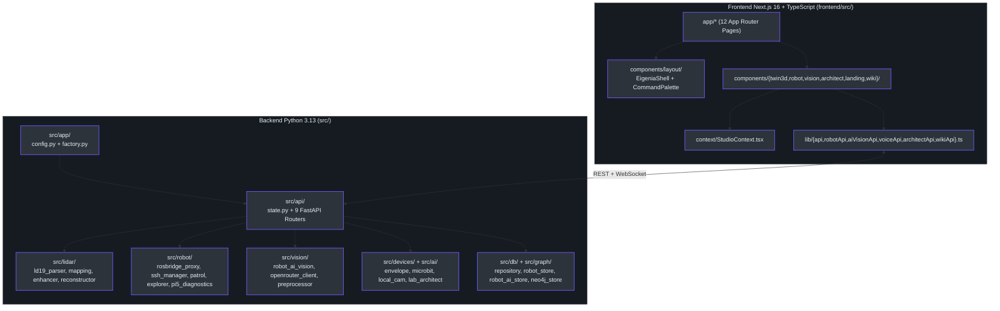
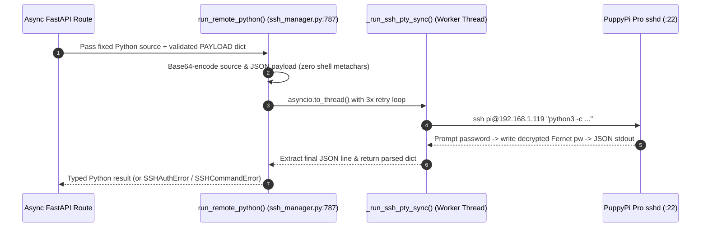

# Developer Architecture & API Reference

This guide equips software engineers to navigate, extend, and verify Eigenia TwinScan cleanly without breaking live hardware safety or the dual InMemory/Postgres test harness.

## 1. Repository Layer Map



## 2. Backend FastAPI Router Catalog (`src/app/factory.py:119`)

| Router File | Prefix | Primary Endpoints |
| --- | --- | --- |
| `src/api/routes_lidar.py:17` | `/api/lidar` | `GET /status`, `GET /snapshot`, `GET/POST /settings`, `POST /filters`, `POST /mode`, `POST /baseline`, `POST /extract-walls`, `POST /register`, `WS /stream`, `WS /ingest` |
| `src/api/routes_twin.py:36` | `/api` | `GET/POST/PATCH/DELETE /spaces`, `POST /spaces/{id}/clone`, `POST /reconstruct/capture-wall`, `POST /reconstruct/capture-360`, `POST /reconstruct/panels/{pid}/enhance`, `GET /reconstruct/export-room.glb`, `GET /export/{fmt}` |
| `src/api/routes_robots.py:67` | `/api/robots` | `POST /discover`, `POST /register`, `POST /{id}/estop`, `POST /{id}/control/*`, `GET /{id}/video/{stream,snapshot}`, `PUT /{id}/config/{wifi,password,mechanics,ros}`, `GET /{id}/hardware-diagnostics`, `POST /{id}/maintenance/clean-logs` |
| `src/api/routes_ai_vision.py:36` | `/api` | `GET /robots/{id}/ai-vision/{stream,state}`, `POST /mode`, `POST /select-target`, `POST /pick-color`, `POST /deep-identify`, `/people/*`, `/patrol/*`, `/explorer/*`, `/spatial-memory` (`GET`/`PATCH`/`POST bulk`/`DELETE`), `/sentry/*` |
| `src/api/routes_voice.py:43` | `/api` | `GET /robots/{id}/voice/status`, `POST /speak`, `POST /chime`, `POST /diagnostics`, `POST /conversation/{start,stop,chat}`, `/personalities/*` |
| `src/api/routes_devices.py:30` | `/api` | `GET /devices/profiles`, `GET/POST/PATCH/DELETE /devices`, `GET /devices/microbit/probe`, `POST /devices/microbit/command`, `GET /devices/pizero/gadget-script`, `POST /devices/cameras/ingest-media`, `/inventory/*`, `/architect/*` |
| `src/api/routes_enrichment.py:24` | `/api` | `GET /spaces/{id}/focus-queue`, `POST /equipment/{id}/enrich`, `POST /spaces/{id}/archive-snapshot` |
| `src/api/routes_vision.py:15` | `/api/vision` | `GET /models`, `POST /analyze` (OpenRouter industrial nameplate extraction + barcode decoding) |
| `src/api/routes_admin.py:19` | `/api` | `GET/PUT /api/admin/settings`, `POST /api/admin/openrouter/test-key`, `GET /api/files/{file_id}` |
| `src/api/routes_wiki.py` *(new)* | `/api` | `GET /api/wiki/catalogue`, `GET /api/wiki/pages`, `GET /api/wiki/pages/{slug}`, `GET /api/early-bird/status`, `POST /api/early-bird/claim` |

## 3. Core Engineering Patterns

### A. ROSBridge Auto-Type Watchdog (`src/api/state.py:335`)
When TwinScan attaches to PuppyPi Pro's ROS 2 Humble `rosbridge_websocket` (`:9090`), `start_robot_ros2_bridge()` subscribes to `/scan`, `/ros_robot_controller/imu_raw`, and `/ros_robot_controller/battery`. Every incoming `LaserScan` JSON message is converted by `laserscan_to_lidar_points()` (`src/robot/rosbridge_proxy.py:254`), rotated by `filter_config.rotation_offset_deg` (`90°` default for PuppyPi forward), filtered, and broadcast to WebSocket clients with a reconnect backoff watchdog if the Pi drops off Wi-Fi.

### B. Zero-Injection Stdlib PTY SSH Runner (`src/robot/ssh_manager.py:746`)
Instead of adding `paramiko`, TwinScan runs SSH over Python's stdlib `pty` module inside `asyncio.to_thread()` (`run_ssh_command()` at `src/robot/ssh_manager.py:746`):



### C. Testing & Verification Harness (`tests/`)
TwinScan's `pytest` suite (`154+` tests, expanding to `158+` with Wiki & Early Bird routes) injects `InMemoryTwinRepository`, `InMemoryRobotStore`, and `InMemoryRobotAiStore` directly into `create_app()` (`src/app/factory.py:119`), so every FastAPI endpoint and algorithm runs deterministically in `<10 s` with zero external database dependency.

```bash
# 1. Verify no main.py exists and run full Python test suite (0 warnings)
test ! -f main.py && .venv/bin/pytest -v

# 2. Verify strict TypeScript and Next.js 16 static prerender build
cd frontend && npm run typecheck && npm run build
```

## 4. Non-Negotiable Coding Standards

| Rule | Requirement | Enforcement Location |
| --- | --- | --- |
| **Senior Architect Modularity** | Never create `main.py`; keep modular files in `src/` with Google-style docstrings | `src/app/factory.py:119` |
| **Test-First Mandate** | Every new Python function/route ships with `pytest` tests in `tests/` | `tests/test_*.py` |
| **Frontend Design System** | Pure Tailwind CSS + `@/components/ui/*` + `lucide-react`; ZERO raw CSS files or invented classes | `frontend/src/components/ui/` |
| **Error & Retry Policy** | Wrap external HTTP/SSH/serial calls in `try/except`, log to `sys.stderr`, retry up to `3×` | `src/robot/ssh_manager.py:746`, `src/ai/lab_architect.py:106` |
| **No Dependency Hallucination** | Use only packages listed in `requirements.txt` and `frontend/package.json` | `requirements.txt`, `frontend/package.json` |
| **Typed Generics in Docs** | Always escape generics in VitePress Markdown backticks (e.g., `` `Dict<string, unknown>` ``) | `docs/wiki/*.md` |

## References

- FastAPI app factory and lifespan (`src/app/factory.py:119`)
- Runtime state and ROSBridge subscriber (`src/api/state.py:335`)
- ROSBridge command clamping and LaserScan decoder (`src/robot/rosbridge_proxy.py:254`)
- Stdlib PTY SSH and base64 Python runner (`src/robot/ssh_manager.py:746`)
- Devices, Inventory, and Lab Architect router (`src/api/routes_devices.py:30`)
- Frontend API base client (`frontend/src/lib/api.ts:21`)
