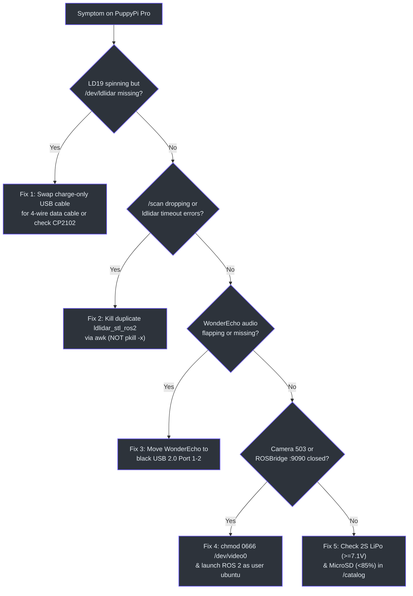
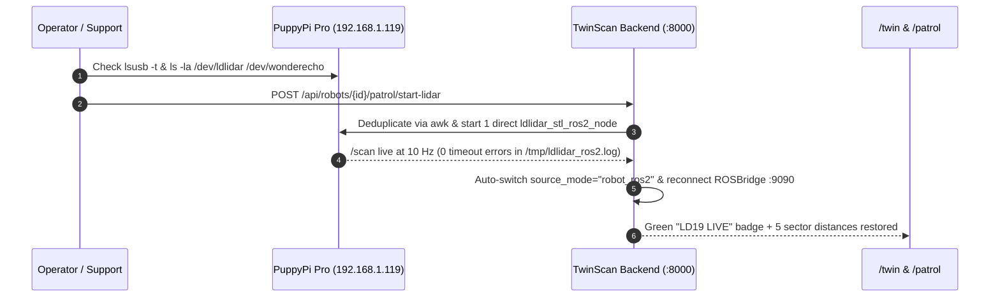

# Support & Troubleshooting Runbook

Every failure mode documented in this runbook was encountered, root-caused, and verified live on a real **Hiwonder PuppyPi Pro** (`Raspberry Pi 5 Model B Rev 1.1`, `192.168.1.119`). Use the decision tree below to jump straight to the exact fix.

## Rapid Hardware Triage Tree



## Symptom-to-Fix Quick Reference

| # | Symptom | Verified Root Cause | Permanent Fix | Source Citation |
| --- | --- | --- | --- | --- |
| **1** | LD19 LiDAR spins physically, yet `/dev/ldlidar` is absent & `lsusb` shows no CP2102/CH340 | LD19 motor only needs `5 V + GND`; a **charge-only 2-wire USB cable** (missing `D+/D-`) spins the rotor with zero USB enumeration | Swap to a verified **4-wire data USB cable** (or test converter on Mac for `/dev/cu.usb*`). Pi 5 USB power is NOT port-specific (`1600 mA` shared rail). | `src/robot/pi5_diagnostics.py:454` |
| **2** | `/scan` stutters or `/tmp/ldlidar_ros2.log` spams `get ldlidar data is time out` | Linux `/proc/<pid>/comm` truncates at **15 chars**, so `pkill -x ldlidar_stl_ros2_node` (21 chars) silently fails, spawning 2–4 competing processes | Kill via `ps -eo pid,args \| awk '/ldlidar_stl_ros2/ && !/awk/ {print $1}'` and launch the direct C++ binary once (`ps_count == 1`). | `src/robot/ssh_manager.py:2431` |
| **3** | WonderEcho Pro audio/mic disconnects repeatedly (`usb 3-1: error -19`) | Plugged into Pi 5 blue USB 3.0 Port `3-1` with intermittent link resets | Move WonderEcho Pro to **black USB 2.0 Port `1-2`** (`0` flaps verified); TwinScan auto-detects Card 2/3 dynamically via `parse_usb_audio_card_index()`. | `src/robot/voice_manager.py:780` |
| **4** | `usb_cam` fails to open camera or `ros_robot_controller` throws `No module named 'serial'` | `/dev/video0` lacks `0666` permissions, or container nodes launched as `root` instead of `ubuntu` (`pyserial` is in `/home/ubuntu/.local`) | Run `sudo chmod 666 /dev/video0 /dev/video1 /dev/rrc` and launch all ROS 2 nodes via `sudo docker exec -d -u ubuntu puppypi_ros2 ...`. | `src/robot/ssh_manager.py:536` |
| **5** | Patrol / Explorer halts with `stopped_lidar_lost` during brief Wi-Fi hiccup | Secondary ROSBridge socket paused `>1.5 s` while primary `/scan` was still alive | Hardened `RobotPatrolManager` warm-starts from verified live runtime `/scan` points, holds `paused_lidar_wait` (`0 m/s`) for `1.5–4.5 s`, and halts only `>4.5 s`. | `src/robot/patrol_engine.py:316` |
| **6** | Explorer unexpectedly enters `returning_home` mid-room | 2S LiPo voltage dropped to `<=25%` (`~7.10 V`) under walking load | Normal safety RTH! Let PuppyPi dock at AprilTag `#0`, power off, and balance-charge the 2S LiPo to `8.4 V`. | `src/robot/explorer_engine.py:40` |
| **7** | MicroSD usage warning (`>=85%`) in `/catalog` | Accumulated rotated ROS logs in `/home/ubuntu/.ros/log` and `/tmp/*lidar*.log` | Click **`Clean Stale Logs`** on `/catalog` (`POST /api/robots/{id}/maintenance/clean-logs`), pruning only `>24 h` stale logs. | `src/robot/ssh_manager.py:2556` |
| **8** | `apriltag` AI Vision mode threw `IndexError` on OpenCV 5.1 | OpenCV `5.1.0` returns 1D `(N,)` `ids` instead of 2D `(N, 1)` | Fixed in `detect_apriltags()` using `int(np.asarray(tag_id_arr).ravel()[0])`. | `src/vision/robot_ai_vision.py:674` |

## Recovery Sequence: Re-Attaching Live ROS 2 `/scan` After Wi-Fi Drop



## Essential Live Health & Log Commands

### On Your Workstation (Docker Stack)
```bash
# Check container health & backend /health JSON
docker ps --format "table {{.Names}}\t{{.Status}}"
curl -s http://localhost:8000/health | python3 -m json.tool

# Verify live LiDAR source mode, Hz, and cardinal clearances
curl -s http://localhost:8000/api/lidar/snapshot | python3 -c '
import sys, json; d = json.load(sys.stdin)
print({k: d.get(k) for k in ("source_mode","actual_hz","scan_count","point_count","robot_scan_connected","rotation_offset_deg","cardinal_m")})'

# Pull live Pi 5 PMIC voltages, USB budget, and 22-component verdict
curl -s http://localhost:8000/api/robots/8131755c-5245-41eb-8780-531a1942e03e/hardware-diagnostics | python3 -m json.tool | head -n 40
```

### Directly on PuppyPi Pro (`ssh pi@192.168.1.119`)
```bash
# 1. Verify USB tree, serial symlinks, and ALSA audio card
lsusb -t && ls -la /dev/ldlidar /dev/wonderecho /dev/video0 /dev/rrc && arecord -l

# 2. Verify PMIC voltages, temperature, and zero throttling
vcgencmd pmic_read_adc | grep -E "EXT5V_V|VDD_CORE" && vcgencmd get_throttled && vcgencmd measure_temp

# 3. Verify exactly 1 ldlidar process and measure /scan Hz
sudo docker exec -u ubuntu puppypi_ros2 bash -c '
  source /opt/ros/humble/setup.bash
  export RMW_IMPLEMENTATION=rmw_cyclonedds_cpp ROS_LOCALHOST_ONLY=0 ROS_DOMAIN_ID=0
  echo "ldlidar_count=$(ps -eo pid,args | awk "/ldlidar_stl_ros2/ && !/awk/ {c++} END {print c+0}")"
  ros2 node list
  timeout 4 ros2 topic hz /scan
'
```

## References

- Persistent udev rules for `/dev/ldlidar` and `/dev/wonderecho` (`src/robot/ssh_manager.py:2327`)
- Single-instance LD19 launcher (`awk` deduplication) (`src/robot/ssh_manager.py:2431`)
- Safe 24h stale log cleaner (`src/robot/ssh_manager.py:2556`)
- Pi 5 PMIC, USB flap counter, and LD19 cable verdict (`src/robot/pi5_diagnostics.py:192`)
- Dynamic USB ALSA card auto-detector (`src/robot/voice_manager.py:780`)
- Patrol LiDAR jitter pause & recovery loop (`src/robot/patrol_engine.py:316`)
- Explorer low-battery 2S LiPo RTH & AprilTag `#0` (`src/robot/explorer_engine.py:40`)
