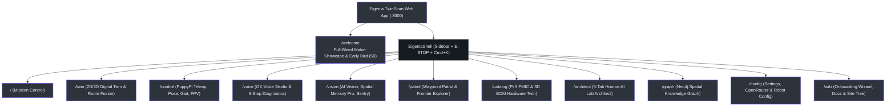
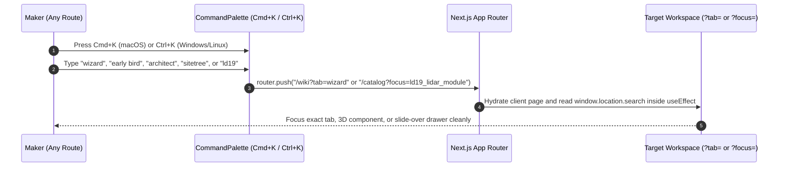

# Complete UI & API Site Tree

This reference maps every single user-facing screen, deep-linked `?tab=` / `?focus=` query parameter, slide-over drawer, `⌘K` Command Palette action, and backend FastAPI router prefix across Eigenia TwinScan (`frontend/src/components/layout/EigeniaShell.tsx:67`, `src/app/factory.py:119`).

## Visual Application Site Map

## Complete Frontend Route & Deep-Link Table

| Route | Shell Layout | Query Params / Sub-Tabs | Primary Component(s) | Key Capabilities |
| --- | --- | --- | --- | --- |
| `/welcome` | **Full-bleed** (no sidebar; `⌘K` active) | Anchor hashes (`#twin`, `#architecture`, `#puppypi`, `#early-bird`) | `MakerLandingPage.tsx`, `LandingHeroTwin3D.tsx`, `LandingArchitectureFlow.tsx`, `EarlyBirdSection.tsx` | Stylized Three.js PuppyPi Pro hero, React Flow cyber-physical map, PuppyPi worked story, 50-spot Early Bird reservation |
| `/` | `EigeniaShell` | — | `frontend/src/components/MissionControlLanding.tsx:37` | Fleet overview, live space metrics, quick launch cards |
| `/twin` | `EigeniaShell` | — | `frontend/src/components/StudioWorkspace.tsx:117`, `DigitalTwin3D.tsx:89`, `BabylonTwinCanvas.tsx:49`, `SceneReconstructionBar.tsx:111`, `RoomSceneManager.tsx:56` | 2D Tactical Radar, Dual 3D Three.js/Babylon.js, 5-Pass Fusion (`Fast`/`Balanced`/`Studio Ultra`), Full-Room `.glb`, Kalman Tracks, Room Manager |
| `/control` | `EigeniaShell` | — | `frontend/src/components/robot/RobotControlPanel.tsx:344` | Live FPV video, velocity joystick, stance/pose presets, gait sliders, 38 action groups, servos, RGB/OLED/buzzer |
| `/voice` | `EigeniaShell` | `?tab=studio\|chat\|personalities\|pipeline\|diagnostics` | `frontend/src/components/robot/VoiceControlPanel.tsx:359`, `VoicePipelineFlow.tsx:60` | WonderEcho ALSA mixer, Piper/Edge TTS, Hands-Free `"Hey OX"` chat, Personalities, React Flow pipeline, 6-Step Diagnostics & Live Mic Test |
| `/vision` | `EigeniaShell` | `?tab=live\|memory\|sentry` | `frontend/src/components/robot/AiVisionStudioPanel.tsx:124`, `SpatialMemoryGallery.tsx:107` | 6 AI Vision modes, Known People enrollment, Spatial Memory Pro (`Bento`/`Small`/`Line` + Slide-Over Drawer), Sentry Guard Mode |
| `/patrol` | `EigeniaShell` | `?tab=patrol\|explorer` | `frontend/src/components/robot/PatrolPlannerPanel.tsx:81`, `AutonomousExplorerPanel.tsx:119` | Click-to-set waypoints, 5-sector live LD19 VFH, Autonomous Dark-Zone Explorer, Low-Battery RTH + AprilTag `#0`, Live FPV PiP |
| `/catalog` | `EigeniaShell` | `?focus=<component_id>` (e.g. `?focus=ld19_lidar_module`) | `frontend/src/components/robot/RobotCatalogPanel.tsx:236`, `Pi5HardwareTwin3D.tsx:314`, `Pi5TopologyFlow.tsx:60` | Live Pi 5 PMIC/Wattage/USB strip, Clean Stale Logs, 22-Component Exploded 3D Pi 5 Twin, Bidirectional 3D↔BOM cross-probing, SBOM |
| `/architect` | `EigeniaShell` | `?tab=studio\|ideas\|inventory\|profiles\|blueprints` | `frontend/src/components/architect/LabArchitectStudio.tsx:265`, `CoDesignAssembly3D.tsx:295` | 5-Tier Creativity Dial, 4 Specialist Lenses, 2D Wiring + 3D Assembly Split View, Lab Inventory CRUD, micro:bit 5×5 Studio, Pi Zero Gadget Script |
| `/graph` | `EigeniaShell` | — | `frontend/src/components/graph/KnowledgeGraphPanel.tsx:320` | Interactive Neo4j 5 spatial knowledge graph, proximity edges, equipment & room relationships |
| `/config` | `EigeniaShell` | — | `frontend/src/components/admin/AdminConfigPanel.tsx:98`, `RobotRemoteConfigPanel.tsx:86`, `UpdateAndFeatureCheckPanel.tsx:157` | OpenRouter keys & model picker, Robot Wi-Fi/SSH/Mechanics/ROS 1↔2 config, APT/pip update dry-run & rollback |
| `/wiki` | `EigeniaShell` | `?tab=wizard\|docs\|sitetree` + `&page=<slug>` | `WikiWorkspace.tsx`, `OnboardingWizard.tsx`, `WikiDocReader.tsx`, `SiteTreeExplorer.tsx` | 10-Step Interactive PuppyPi Pro Onboarding Wizard, Full Mermaid-rendered Docs Reader, Interactive Site Tree |

## `⌘K` Command Palette Navigation Flow (`frontend/src/components/layout/CommandPalette.tsx:50`)

## Slide-Over Drawers & Deep Interactive Controls

| Drawer / Modal | Host Route | Purpose | Source Citation |
| --- | --- | --- | --- |
| **Spatial Memory Detail Inspector** | `/vision` (`memory` tab) | Full-res JPEG preview, editable label/kind/notes/tags, JPEG download, Archive/Retrieve, Delete | `frontend/src/components/vision/SpatialMemoryGallery.tsx:107` |
| **Add Lab Inventory Part Drawer** | `/architect` (`inventory` tab) | Create owned/wishlist hardware items with profile, voltage, current, and interfaces | `frontend/src/components/architect/LabArchitectStudio.tsx:265` |
| **Tuning & Panels Drawer** | `/twin` | 6 composite enhancement pass switches, captured panel thumbnails, `Enhance`, `.glb` download | `frontend/src/components/twin3d/SceneReconstructionBar.tsx:111` |
| **Global Command Palette** | All 12 routes (incl. `/welcome`) | Instant fuzzy search across workspaces, tabs, robot actions, and wiki pages | `frontend/src/components/layout/CommandPalette.tsx:50` |

## Backend FastAPI Router Prefix Summary (`src/app/factory.py:119`)

| Router Prefix | Source Module | Primary Consumers |
| --- | --- | --- |
| `/health` | `src/app/factory.py:231` | Docker healthcheck, `/config`, `/wiki?tab=wizard` |
| `/api/lidar/*` | `src/api/routes_lidar.py:17` | `/twin`, `/patrol`, `StudioContext` |
| `/api/spaces/*` | `src/api/routes_twin.py:36`, `src/api/routes_enrichment.py:24` | `/twin`, `/graph`, `/` |
| `/api/robots/*` | `src/api/routes_robots.py:67` | `/control`, `/catalog`, `/config`, global E-STOP |
| `/api/robots/*/ai-vision/*`, `/api/people/*`, `/api/spatial-memory*`, `/api/*/patrol/*`, `/api/*/explorer/*`, `/api/*/sentry/*` | `src/api/routes_ai_vision.py:36` | `/vision`, `/patrol` |
| `/api/robots/*/voice/*`, `/api/voice/*` | `src/api/routes_voice.py:43` | `/voice` |
| `/api/devices/*`, `/api/inventory/*`, `/api/architect/*` | `src/api/routes_devices.py:30` | `/architect` |
| `/api/vision/*` | `src/api/routes_vision.py:15` | `/twin`, `/control` |
| `/api/admin/*`, `/api/files/*` | `src/api/routes_admin.py:19` | `/config`, `/twin`, `/vision` |
| `/api/wiki/*`, `/api/early-bird/*` | `src/api/routes_wiki.py` | `/wiki`, `/welcome` |

## References

- Navigation shell and full-bleed `/welcome` handler (`frontend/src/components/layout/EigeniaShell.tsx:67`)
- Command Palette shortcuts (`frontend/src/components/layout/CommandPalette.tsx:50`)
- FastAPI router registration (`src/app/factory.py:119`)
- Spatial Memory Pro gallery & drawer (`frontend/src/components/vision/SpatialMemoryGallery.tsx:107`)
- Lab Architect 5-tab cockpit (`frontend/src/components/architect/LabArchitectStudio.tsx:265`)
- Devices, Inventory, and Architect API router (`src/api/routes_devices.py:30`)
