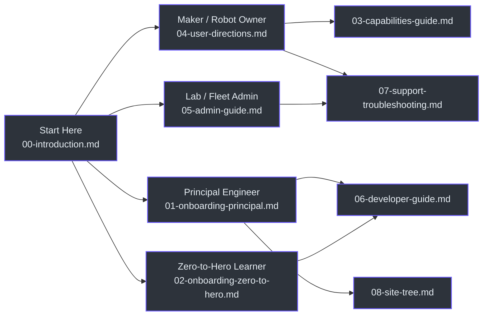
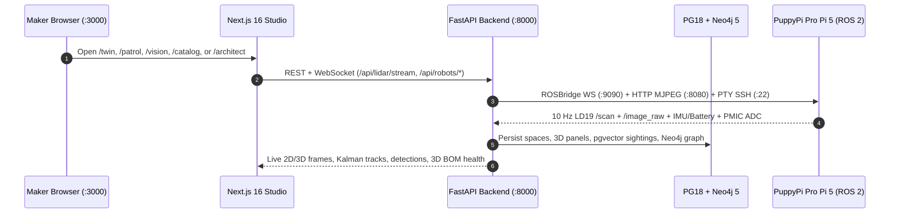

# Eigenia TwinScan Documentation Wiki

Welcome to the engineering and maker wiki for **Eigenia TwinScan** — a 100% local-first robotics, 360° LiDAR, AI vision, conversational voice, and 3D spatial digital twin platform built for real hardware in your lab (`src/app/factory.py:119`). Every worked example, electrical budget, ROS 2 command, and troubleshooting workflow in this wiki is anchored on our flagship live robot: the **Hiwonder PuppyPi Pro** (`Raspberry Pi 5 8 GB + LD19 360° ToF LiDAR + icSpring 640×480 UVC Camera + WonderEcho Pro USB Audio/CH340 + 2S LiPo + ROS 2 Humble`) (`src/devices/envelope.py:272`).

## Why This Wiki Exists

Cyber-physical systems fail at the seams between Linux kernel USB drivers, ROS 2 DDS middleware, async Python control loops, GPU WebGL renderers, and physical battery rails. Rather than scattering tribal knowledge across scripts, this wiki traces real production code paths across `src/` (`src/api/state.py:76`) and `frontend/src/` (`frontend/src/context/StudioContext.tsx:130`) so makers, principal engineers, fleet operators, and contributors share a single evidence-backed source of truth.

## Wiki Navigation & Persona Reading Paths

| Guide | File | Best For | Key Topics Covered |
| --- | --- | --- | --- |
| **Introduction** | `00-introduction.md` | Everyone | Maker-first local philosophy, 6 hardware profiles, PuppyPi Pro hardware stack |
| **Principal-Level Guide** | `01-onboarding-principal.md` | Staff / Principal ICs | Core offloading insight, TypeScript pseudocode, system & ER diagrams, tradeoffs |
| **Zero-to-Hero Path** | `02-onboarding-zero-to-hero.md` | Newcomers / Makers | Python/TS/ROS 2/Three.js/React Flow foundations, dev setup, **45+ term glossary** |
| **Capabilities Guide** | `03-capabilities-guide.md` | Builders & Architects | 5-Pass 3D Fusion, Patrol/Explorer/RTH, Spatial Memory Pro, Voice OX, Lab Architect |
| **User Directions** | `04-user-directions.md` | Robot Operators | Day-1 PuppyPi Pro checklist, scanning rooms, E-STOP safety, 2S LiPo charging |
| **Admin Guide** | `05-admin-guide.md` | Fleet / Lab Admins | Docker Compose, PG18+Neo4j 5, ROS 2 auto-boot systemd, Pi 5 PMIC & log cleanup |
| **Developer Guide** | `06-developer-guide.md` | Contributors | `src/` & `frontend/src/` layers, REST/WS API catalog, stdlib PTY SSH, `pytest` |
| **Troubleshooting** | `07-support-troubleshooting.md` | On-Call / Support | LD19 charge-only cable, 15-char `pkill` bug, WonderEcho USB 2.0 `1-2`, ROSBridge |
| **Site Tree** | `08-site-tree.md` | UX / QA / Devs | All 12 UI routes, URL query tabs, `Cmd+K` palette, and backend router prefixes |

## Recommended Reading Paths by Role

## Platform Runtime At A Glance

Eigenia TwinScan runs a 4-container Docker Compose stack on your workstation (`docker-compose.yml:1`) while talking over local 5 GHz Wi-Fi (`Wildcat`) to PuppyPi Pro's ROS 2 Humble container (`puppypi_ros2`) (`src/robot/ssh_manager.py:2154`):

## Flagship Hardware Reference (Hiwonder PuppyPi Pro)

| Subsystem | Hardware Component | Interface / Port | Source Module |
| --- | --- | --- | --- |
| Compute Host | Raspberry Pi 5 Model B Rev 1.1 (8 GB) | `wlan0` 5 GHz Wi-Fi (`192.168.1.119`) | `src/robot/pi5_diagnostics.py:192` |
| Motion & IMU | Hiwonder RRC STM32 Expansion HAT | UART0 `/dev/rrc -> /dev/ttyAMA0` | `src/robot/rosbridge_proxy.py:103` |
| 360° LiDAR | LDROBOT LD19 ToF (10 Hz, 12 m) | USB-UART `/dev/ldlidar` @ 230400 baud | `src/lidar/ld19_parser.py:228` |
| FPV Camera | icSpring 640×480 UVC (`32e6:9005`) | Pi 5 USB 2.0 Port `1-1` (`/dev/video0`) | `src/vision/robot_ai_vision.py:274` |
| Voice I/O | WonderEcho Pro (`1a86:8091` Hub + Audio) | Pi 5 USB 2.0 Port `1-2` (ALSA Card 2) | `src/robot/voice_manager.py:780` |
| Power | 2S LiPo (7.4 V nom, 8.4 V full) + 5 V Buck | DA9091 PMIC (`EXT5V ~5.0 V`, 1600 mA USB) | `src/robot/explorer_engine.py:40` |

## References

- Application factory and router registration (`src/app/factory.py:119`)
- Runtime telemetry state and ROS 2 bridge loop (`src/api/state.py:76`)
- Docker Compose infrastructure stack (`docker-compose.yml:1`)
- Universal hardware device profiles (`src/devices/envelope.py:272`)
- Frontend navigation shell and global E-STOP header (`frontend/src/components/layout/EigeniaShell.tsx:67`)
- Live Pi 5 PMIC and 22-component 3D BOM diagnostics (`src/robot/pi5_diagnostics.py:192`)
